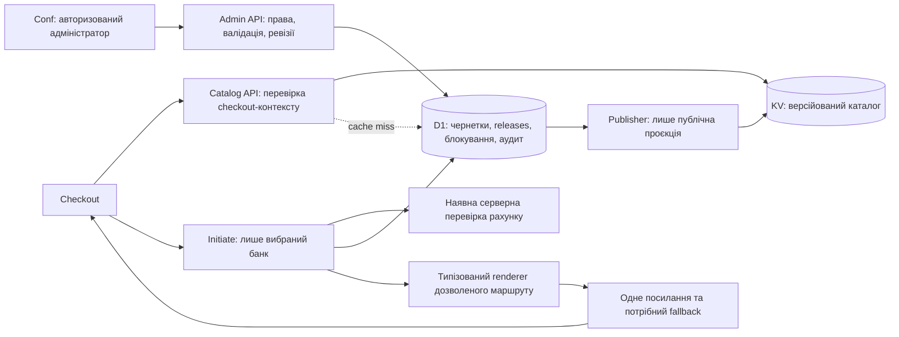

# Conf: зберігання банків у D1 та видача диплінків через Worker

Дата: 2026-09-28. Статус: **пропозиція до погодження, не реалізація**.

### Погоджений проміжний етап: окрема синхронізація

Окремим запитом користувача реалізовано кнопку **«Синхронізувати з D1»** у Conf.
Це не реалізація цільової архітектури нижче: редагування/збереження залишаються
в Supabase `banklink`, а mount і «Оновити» лише читають.

- `POST /conf/api/banks/sync` обробляє окремий Conf Worker, без платіжного API.
- Браузер передає лише bearer-сесію. Worker перевіряє `/auth/v1/user` та явний
    список дозволених user ID, потім читає збережені записи з Supabase з RLS користувача.
    Чернетки браузера, defaults і незбережені поля не імпортуються.
- D1 зберігає приватний JSON-знімок усіх повернутих полів, SHA-256, джерело,
    автора та дату першого імпорту. Однакові дані повертають `unchanged` без дубля.
    Змінені дані створюють новий знімок; активної версії, зворотної синхронізації,
    KV-публікації або зміни Checkout немає.
- Ліміт: 1–500 записів і 1 500 000 байтів відповіді, включно з inline-логотипами.
    Exact count підтверджує повноту лише видимого через RLS набору, не всього `banklink`.
    Це архівування, не перевірка готовності routing-конфігурації до публікації.
    Автоматичного видалення старих знімків немає.

Локальна конфігурація: [wrangler.conf-local.jsonc](../worker/wrangler.conf-local.jsonc).
Вона не має service binding до платіжного Worker. Її ID `local-conf-bank-snapshots`
є локальним ідентифікатором, не ID ресурсу Cloudflare. **Не використовувати її для deploy.**
Після окремого запиту на серверне налаштування тестовий `letsrealtalk-conf`
має binding до `letsrealtalk-conf-snapshots`. Без необхідних bindings/settings
обробник повертає `sync_not_configured`.

Для локальної бази застосуйте всі міграції; вже застосовані Wrangler пропускає:

```powershell
node worker/node_modules/wrangler/bin/wrangler.js d1 migrations apply BANK_CATALOG_DB --config worker/wrangler.conf-local.jsonc --local
node worker/node_modules/wrangler/bin/wrangler.js dev --config worker/wrangler.conf-local.jsonc --local --port 8796 --inspector-port 9246
```

Conf Vite на `http://localhost:5176/conf/` проксіює тільки точний sync endpoint на
порт 8796 зі збереженням Host/Origin. Для справжнього імпорту потрібні серверні
`CONF_SUPABASE_URL`, `CONF_SUPABASE_PUBLISHABLE_KEY`, `CONF_BANK_SYNC_ADMIN_IDS`
(список Supabase Auth UUID через кому) та чинна сесія дозволеного адміністратора.
Налаштовувати локально через ігнорований `.dev.vars` у `worker`, без service-role key.
У відстежуваній конфігурації список адміністраторів порожній; локально в ігнорованому
`.dev.vars` налаштовано явно погоджений користувачем UID та наявні публічні параметри
Supabase. Після перезапуску Worker обидва локальні шляхи (8796 напряму та 5176 через
проксі) повертають `401 authentication_required` без bearer-сесії замість
`503 sync_not_configured`. Не брати дозволи з `user_metadata`.
Подальший запит на серверне налаштування поширюється на тестовий домен
`letsrealtalk.com`, не на production `rakhunok.com`.

Перевірено два серверні тести з реальним локальним D1 API та підставленим Supabase:
відмова без конфігурації, права доступу, збереження невідомих полів, ідемпотентність,
нова ревізія, неповне/некоректне/завелике джерело та збій сховища. Conf check:
0 помилок, 22 наявні попередження; Svelte autofixer без зауважень; вузька перевірка
типів Worker проходить. Реальний браузерний імпорт не перевірено: у спільній вкладці
немає активної сесії, раніше Google OAuth відхиляв localhost origin.

Серверне виправлення 2026-09-28: журнал Conf показав `TypeError` до відповіді
Supabase. Регресійний тест у workerd відтворив `502 auth_unavailable` через
непідтримуваний `redirect: 'error'`. Обидва запити використовують `manual`;
редиректи не виконуються, відповіді 3xx відхиляються. Три тести проходять,
включно з runtime-перевіркою авторизації, блокуванням редиректів, локальним
імпортом і дедуплікацією. Typecheck і Conf dry-run успішні.
Версію `8ee58821-b1cc-48cb-8082-27ba1b37e201` розгорнуто в `letsrealtalk-conf`.
Віддалено підтверджено 401 без токена та з недійсним токеном, 403 для чужого Origin;
`/`, `/dashboard`, `/app`, `/conf/`, `/pay`, `/pay/`, `/corex` і їхні JS/CSS
повертають 200 з відповідними типами ресурсів. Assets не змінювалися.
Реальний авторизований імпорт залишається неперевіреним: спільна вкладка Conf
не авторизована, Google popup блокується. Production і платіжна логіка не змінені.

### Окрема таблиця банків: реалізовано 2026-09-28

Після підтвердженого користувачем імпорту знімка `e41d87a3b474` і окремого
погодження додано `conf_banks` у тестовій D1. Один банк займає один рядок:
`id` є primary key, `payload_json` зберігає весь запис, `code`, `name`, `active`
є STORED generated columns з цього JSON, `snapshot_hash` посилається на історію.
Пошук `code = ? COLLATE NOCASE` використовує індекс `conf_banks_code_idx`.
Збережений JSON та похідні колонки не можуть розійтися через окреме оновлення колонок.

Міграція `0002_conf_banks.sql` перенесла останній знімок: віддалено підтверджено
46 унікальних рядків, 1 288 JSON-полів, 0 розбіжностей зі знімком; історичний
знімок збережений. Наступна синхронізація оновлює таблицю та історію одним
`D1.batch`; банки, відсутні у новому повному наборі, зникають із `conf_banks`,
але залишаються в історії. Повтор того самого набору не дублює записи.

Три тести пройшли з `--experimental-test-isolation=none` після аварійного
завершення ізольованого процесу Windows: workerd, перенесення зі знімка,
оновлення/видалення записів та відкат batch при помилці вставки. Typecheck,
Conf dry-run та діагностика редактора успішні. Розгорнуто тільки `letsrealtalk-conf`,
версія `3c9f4325-2cf0-4436-957c-50207aaf1a12`; assets не змінювалися.
Після deploy сім маршрутів і JS/CSS пройшли smoke check; без/з недійсним токеном
sync повертає 401, чужий Origin отримує 403. Повторний авторизований запуск
кнопки після цієї версії не перевірено. Conf і далі редагує Supabase;
Checkout, KV, production і платіжну логіку не змінено.

## 1. Рішення та межі

Рекомендований цільовий стан: **D1 є єдиним джерелом конфігурації банків**, включно з чернетками й опублікованими версіями. Conf читає та змінює її через захищений адміністративний Worker API. Checkout отримує мінімальний каталог через Worker/KV, а готове посилання лише для одного явно обраного банку після перевірки платіжного контексту сервером.

Попередній варіант Supabase drafts → D1 publication залишається альтернативою, але не базовим рішенням: два сховища редагування ускладнюють конфлікти та синхронізацію. У цьому плані Supabase `banklink` стає джерелом для одноразового імпорту й тимчасового контрольованого відкату, а не другим активним редактором. Наявна Supabase Auth залишається; рахунки, замовлення, суми, платіжні snapshots і settlement не переносяться в D1.

План не дозволяє змінювати runtime, схеми, RLS, маршрути, доступи чи remote-ресурси. `BANK-CATALOG-READ-001` залишається `LOCKED`. Зміни платіжного входу для `fixed`, `open_amount`, `table`, `delivery` потребують окремого погодження. Раніше погоджене виправлення каруселі не є дозволом на цю міграцію.

## 2. Перевірена основа й блокери

| Поточний шлях | Що потрібно врахувати |
| --- | --- |
| [BankEntry](../apps/conf/src/lib/types.ts) та [BankLinkStore](../apps/conf/src/lib/services/banklink-store.ts) | Conf зберігає presentation і повну routing-конфігурацію разом у Supabase `banklink`; помилка/порожній результат можуть підмінятися defaults. Імпорт не повинен використовувати цей fallback. |
| [BankManager](../apps/conf/src/lib/components/BankManager.svelte) | Після окремого виправлення mount/refresh викликає тільки `getAll`; зберегти read-only refresh. |
| [Pay API](../apps/pay/src/lib/services/api.ts) та [статичний каталог](../apps/pay/public/banks.json) | Pay об'єднує bundled/API записи, окремо застосовує logos. Вимкнення або відсутність банку в API не гарантує його зникнення. |
| [Локальний Worker](../worker/src/index.ts) | Каталог читається із Supabase або defaults; генератор посилань використовує hardcoded switch, не шаблони Conf. |
| [Локальний Pay генератор](../apps/pay/src/lib/services/qr-generator.ts) | Дублює routing-логіку, але за попереднім аналізом не викликається активним `executePay`. Не вмикати його як аварійний fallback. |
| [Production checkout config](../worker-rakhunok/wrangler.checkout.jsonc) | API service binding вказує на зовнішній `rahunok`; зміна лише локального Worker не доводить зміну production. |

У попередній локальній перевірці одночасно відображалися `MONO` та `UNJS`; smooth-scroll каруселі тимчасово змінював вибраний банк. Перед запуском нової маршрутизації необхідно підтвердити виправлення і regression test, а не вважати попереднє погодження доказом реалізації.

Власник upstream `bank-api.dmitrishen.workers.dev`, його актуальні bindings та зв'язок із переданим namespace `ee9d6248470a49659247f871d8d1d5c4` не перевірені. Не використовувати цей namespace автоматично.

## 3. Цільовий потік



Це логічні ролі, не вимога розгорнути окремий Worker для кожної. До реалізації визначити одного власника Bank Catalog API і renderer. Якщо потрібна міжсервісна взаємодія, використовувати service binding, а не публічний адміністративний endpoint. D1/KV доступні лише серверним bindings; браузер не отримує Cloudflare credentials.

## 4. Розподіл даних

| Поля Conf | Цільове зберігання | Що отримує Checkout |
| --- | --- | --- |
| `id`, `code`, `name`, `color` | D1: стабільна ідентичність і версійоване presentation | `id`, canonical `code`, `name`, `color` |
| `logo` | D1: reference/hash; наявні static assets або окреме object storage для завантажень | Безпечний публічний `logo_url` |
| `active` | Published config; окреме оперативне блокування має вищий пріоритет | Лише дозволені записи; відсутність не дає права на fallback |
| `nbu_version`, `encoding`, `nbu_function`, `domain_prefix` | Приватна routing-ревізія D1 | Не передавати як каталог конфігурації |
| `android_package`, `android_intent`, `ios_scheme` | Приватна routing-ревізія D1 | Не передавати у списку |
| `universal_link`, `universal_link2`, `url_template`, `alternative_url`, `extra_links` | Приватна routing-ревізія D1 | Лише результат renderer для вибраного банку |
| `routing_mode`, `mode`, `appstore_url`, `playstore_url` | Приватна routing-ревізія D1 | Тільки потрібний обраному сценарію redirect/fallback |
| `checked`, `verified`, `last_test_result`, `last_test_at` | Приватні результати перевірок із revision/hash і автором | Не передавати |
| `created_at`, `updated_at` | D1 metadata; початкові значення зберегти як import provenance | Не передавати |

Повний початковий запис зберігати як приватний migration snapshot для звірки без втрат. Невідомі/некоректні поля поміщати у звіт, не публікувати автоматично. `extra_links` спочатку зберегти без втрати значення, потім нормалізувати в обмежений структурований формат.

Логотипи до 512 KiB, які зараз можуть бути inline, не дублювати в кожному release або KV-каталозі. На імпорті перевірити MIME, розмір і вміст; відхиляти активний SVG/HTML або безпечно перетворювати у raster. Сховище завантажень обрати окремо; R2 не є обов'язковим для вже наявних статичних assets.

`TestFormData` з реквізитами одержувача не включати в каталог чи автоматичний аудит. Переноситься конфігурація, не історія реальних платіжних payload. Банківські API credentials не є частиною цієї моделі.

## 5. Логічна модель D1

Нижче проєкт сутностей, не SQL-міграція; остаточні constraints та індекси погоджуються під час реалізації.

| Сутність | Призначення й інваріант |
| --- | --- |
| `banks` | Незмінний внутрішній ID, canonical code; code унікальний без урахування регістру. |
| `bank_aliases` | Старий code/id → один bank ID; aliases не можуть конфліктувати з canonical identity. |
| `bank_revisions` | Конфігурація чернетки/immutable validated revision, schema version, content hash, автор; optimistic concurrency для редагування. |
| `catalog_releases` | Immutable повний manifest bank ID → revision ID, environment, hash, публічна проєкція. |
| `catalog_state` | Єдиний активний release для середовища; CAS activation запобігає втраченим конкурентним публікаціям. |
| `bank_controls` | Оперативне disabled/blocked, причина й час; не відкочується разом із release. |
| `bank_test_runs` | Результат перевірки конкретного revision hash, OS, renderer version і reviewer; без фінансових payload. |
| `catalog_publish_jobs` | Durable outbox для побудови KV, retries, статус і остання sanitized помилка. |
| `bank_audit_events` | Автор, дія, revision/release, timestamp, request ID; журнал недоступний для редагування звичайним Admin API. |

Погодити один canonical code Monobank із сумісністю чинних клієнтів; `MONO` і `UNJS` після звірки представляють один bank ID, а не дві картки. Не переписувати історичні order/attempt записи. Вибір у UI прив'язати до стабільного bank ID, не тільки індексу масиву.

Використовувати параметризовані SQL-запити, унікальні constraints, foreign keys та індекси lookup за code/alias/release. Admin API не приймає довільний SQL. Локальна D1 ізольована від production; dev/test та production мають окремі bindings і дані.

## 6. Conf та публікація

1. **Оновити**: тільки прочитати D1 через Admin API; не backfill, не publish і не синхронізація з KV.
2. **Зберегти чернетку**: перевірити права editor і expected revision; конфлікт повертає `409`, не перезаписує чужі зміни.
3. **Перевірити**: тестувати саме збережений revision/hash, не іншу копію selectedBank. Зміна конфігурації анулює придатність попереднього test approval.
4. **Опублікувати**: окрема явна команда з diff, результатами OS-перевірок та правами publisher. `checked=true` або `verified=true` із defaults не є approval.
5. У D1 атомарно зафіксувати immutable release, active pointer через CAS, audit і outbox. При помилці не залишати частково активований release.
6. Publisher створює тільки allowlisted публічну проєкцію у KV. Помилка KV не відкочує непомітно D1: Conf показує «активовано, кеш очікує», job повторюється ідемпотентно.
7. **Вимкнути банк**: окрема підтверджена дія, що записує оперативне блокування в D1 та планує оновлення каталогу. Не чекати поширення KV для заборони initiation.

Supabase Auth можна зберегти як identity provider, але Worker повинен перевіряти token signature, issuer, audience, expiry та серверні права. Сам факт login не надає ролі editor/publisher; user-editable metadata не є джерелом ролей. Для привілейованих дій перевіряти актуальні права, враховуючи затримку оновлення claims. Секретні ключі не потрапляють у Vite env/browser bundle. Для cookie-based auth потрібен CSRF-захист.

## 7. Контракти Checkout

Шляхи нижче є пропозицією; перед змінами скласти inventory клієнтів чинного API.

- `GET /api/v1/banks`: allowlisted response `schema_version`, `catalog_revision`, `banks[{id,code,name,logo_url,color}]`. Жодних routing fields або повного `BankEntry`.
- Для максимального обмеження автоматичного збору список видається тільки після перевірки короткоживучого checkout-контексту. Авторизація відбувається **до** читання загальної KV-проєкції; контекст не входить у публічну cache key.
- Контекст прив'язаний до server-resolved invoice, environment, expiry і checkout session. Сам short ID не вважати секретом; доступ до публічного invoice не перетворює каталог на конфіденційний ресурс. Для його власника перелік усе одно видимий.
- `POST /api/v1/checkout/{id}/initiate`: зберегти сумісні поля чинного запиту; приймати ідентичність банку, не довільний template/URL/package. OS є підказкою для routing, не доказом права доступу.
- Worker повторно перевіряє рахунок, статус/строк дії, права контексту та наявні правила суми. Сума, одержувач, призначення, reference і snapshots залишаються під чинною серверною authority.
- Одним узгодженим primary lookup прочитати alias → bank → active release/revision + оперативний block. Невідомий, неопублікований або вимкнений банк: відмова, без підміни іншим банком чи NBU/default router.
- Renderer формує лише обраний маршрут. Відповідь містить redirect і потрібний fallback, а не всі OS/alternative templates. Переглянути існуючі raw NBU/debug поля та прибирати непотрібне тільки після перевірки клієнтських залежностей.
- Відповіді initiation, admin і checkout-context мають `Cache-Control: no-store`; диплінки не зберігаються у KV, CDN, analytics, localStorage або access logs із body/Location.
- Повторний запит initiation не повинен створювати нову фінансову спробу безконтрольно: використати чинний механізм attempt/idempotency або погодити його окремо. Якщо потрібен одноразовий nonce, споживати його атомарно в authoritative сховищі, не KV; підписаний JWT сам не гарантує одноразовість.

Не створювати публічний full-detail `/banks/{code}` із routing-конфігурацією. Раніше запитаний повний upstream JSON потрібен для адміністративного експорту/міграції, не як контракт Checkout. Адміністративний export потребує окремих прав, журналювання і `no-store`.

## 8. KV: швидкість без права дозволяти оплату

KV обрано як спільну між Worker-читачами похідну конфігурацію, що явно публікується, відповідно до вимоги KV + Worker. Окремий шар Workers Cache/CDN на першому етапі не додавати: він ускладнює stale-state контроль; переглянути лише після вимірювання.

- Immutable ключ: `banks:{env}:v1:release:{releaseId}:public`; значення містить тільки публічну проєкцію, hash, revision і schema version.
- `banks:{env}:v1:current` є лише підказкою release ID. Запис pointer після snapshot не гарантує однакової видимості обох ключів у всіх регіонах.
- Cache miss, negative cached lookup, відсутній snapshot, невірна schema/hash або прострочена freshness-позначка: прочитати актуальний public projection із D1 та запланувати repair. Читач не перезаписує `current` зі своєї застарілої копії.
- Публікації/retries впорядковує один publisher для середовища з durable job/claim. Старі jobs не повинні навмисно повертати `current` назад; KV не використовувати для CAS/lock. Навіть запізнілий запис залишається лише stale hint і не дає права initiation.
- Початкова пропозиція: `cacheTtl` mutable hint 60 секунд, application freshness deadline 5 хвилин, immutable snapshot retention 30 днів. Freshness рахується від записаної сервером перевірки active state, а не від кожного cache hit. Deadline не подовжується читанням; publisher періодично оновлює її після D1-перевірки. Значення уточнити за навантаженням, тарифом і погодженим stale budget.
- Для контекстно захищеної видачі browser response має `private, no-store`; KV всередині Worker залишається спільним і не містить даних invoice. Не дозволяти CDN повернути відповідь до auth-перевірки.
- KV недоступний → контрольований D1 fallback із бюджетом навантаження; за перевантаження відмова, не hardcoded banks. Прострочений кеш + недоступна D1 → `503`/стан недоступності. Відсутність банків у валідному release є допустимим порожнім результатом, не приводом відновити defaults.

**Блокування:** кожен initiation робить authoritative primary lookup. При використанні D1 Sessions API перший запит виконувати через `withSession('first-primary')`, а не довільну read replica; зібрати стан рішення в одному запиті. Якщо перевірка починається після commit блокування, банк має бути відхилений незалежно від KV. Запит, який пройшов перевірку до commit, і вже виданий зовнішній URL неможливо ретроспективно відкликати цією схемою. Суворіша координація конкурентного disable/initiate потребує окремого дизайну.

Швидкий список і додатковий primary round trip лише при оплаті є свідомим компромісом. Не кешувати приватний router у KV в першій версії: для невеликого каталогу складність інвалідації не виправдана до вимірювань.

## 9. Захист і його реальні межі

**Неможливо приховати від користувача перелік банків, який показує його браузер, або фінальний URL, який цей браузер відкриває.** TLS захищає передачу від пасивного мережевого перехоплення, але не від DevTools, розширень або авторизованого клієнта. Уже опубліковані посилання неможливо зробити невідомими заднім числом.

Досяжна мета: не видавати повний набір конфігурацій одним запитом, захистити адміністративний доступ, обмежити масове автоматичне отримання маршрутів і не дозволити підміну призначення платежу.

| Ризик | Контроль |
| --- | --- |
| Масове отримання конфігурації | Public allowlist, відсутність full-detail route, checkout context; private templates залишаються в D1. |
| Автоматичний перебір банків | Rate limits за session/invoice/IP і загальним бюджетом, обмеження context minting, `429` та спостереження за enumeration; shared IP не є єдиним критерієм. |
| Підроблений bot token | Turnstile Siteverify на сервері з перевірками hostname/action і правил токена; frontend token collection недостатньо. |
| Зміна URL на шахрайський | Типізовані placeholders, allowlist host/scheme/package, перевірка кінцевого URL після підстановки, незалежне погодження нового destination. |
| Довільний код/SSRF у конфігурації | Жодного eval/JS template або fetch довільного endpoint; remote logo imports також потребують окремої egress-політики. |
| Витік із логів | Логувати request ID, bank ID, release ID, outcome, latency; не повні URL, NBU, IBAN, ПІБ чи токени. |
| Несанкціонована публікація | Server RBAC, окремі edit/publish права, audit, revision CAS; звичайний API не може видаляти аудит. |
| Обхід нового API | Прибрати routing із static bundles, старих API, public Supabase читання та upstream endpoints під нашим контролем. Перевірити всі hostname/routes. |

CORS, приховані назви полів, обфускація, випадковий bank ID і шифрування з ключем у браузері не є захистом конфіденційності. CSP та захист від XSS корисні, але не приховують дані від легітимного одержувача. One-time redirect relay можна розглядити для контролю використання, проте `Location` також видимий і custom schemes потребують мобільних перевірок; це не обов'язковий перший етап.

Renderer не повинен автоматично застосовувати будь-які значення Conf до NBU payload. Версія/encoding/function та підстановка reference мають пройти parity fixtures з поточним фінансовим контрактом. Для Monobank зберегти підтверджену поточну HTTPS-поведінку до окремої перевірки Android intent/iOS змін. OS-матриця включає iPad із desktop UA.

## 10. Етапи переходу й погодження

1. **Інвентаризація, без записів.** Визначити production API owner, account/bindings/routes та всіх читачів `banklink`, `banksy`, upstream, `/banks/{code}`, static catalog. Зняти повний авторизований snapshot list/detail із provenance/hash; errors не маскувати defaults. Підготувати mapping і звіт MONO/UNJS, дублікатів та невалідних templates. Власність namespace підтвердити окремо.
2. **Локальна модель.** Після погодження реалізації додати локальні D1 migrations, importer dry-run і schema/renderer fixtures. Звірити кількість банків, кожне поле й aliases; жодної автоматичної remote міграції.
3. **Admin API і Conf.** Реалізувати права, drafts, перевірку конкретної ревізії, publish/outbox та read-only refresh. Зберегти Auth. Редагування ще не змінює чинний checkout до явного cutover.
4. **Shadow-перевірка.** Створювати D1/KV public projection і порівнювати зі snapshot. Renderer перевіряти на синтетичних invoices без реальних initiation/банківських переходів. Не робити подвійні платежі під назвою shadow.
5. **Тестовий cutover.** Окремо погодити зміну `BANK-CATALOG-READ-001` і payment entry для чотирьох сценаріїв, список файлів та інваріанти. Перемкнути каталог, прибрати bundled merge/default resurrection і окремі некеровані logo overrides. Підключити один renderer і стабільний selected-bank ID. Перевірити всі клієнти API.
6. **Production cutover.** Після окремого дозволу: коротке freeze редагування старого джерела, фінальний delta import зі звіркою, activation перевіреного release, перемикання єдиного writer на D1. Уникати dual-write; зберегти резервну копію. Розгортати тільки через дозволений production pipeline із належними build/dry-run та route smoke tests.
7. **Закриття legacy-витоків.** Після перевірки залежностей окремо погодити обмеження старого Supabase/API доступу, видалення routing із public assets і очищення контрольованих CDN copies. Якщо зовнішній upstream не належить нам, його відкритість залишається задокументованим обмеженням.

Зміни Supabase grants/RLS, D1 remote import, ресурси Cloudflare, authentication policy, тарифні витрати й deployment мають окремі approval gates. Цей документ не запускає жодного з них.

## 11. Відкат та відмови

- Config rollback: створити аудований activation попереднього сумісного immutable release; оперативні bank blocks зберігаються. KV перебудовується з D1, не стає джерелом відновлення приватних даних.
- Code rollback: лише на версію, сумісну з active config schema. Не повертати автоматично старий публічний endpoint, який розкриває templates, і не вмикати browser routing fallback.
- Після початку редагування в D1 не перемикати writer назад на застарілий Supabase snapshot без freeze та звірки delta; інакше втратяться зміни.
- Недоступність authoritative bank lookup: відмова в новому redirect; не змінювати invoice на paid/failed. Чинний status/settlement flow працює незалежно від каталогу.
- Відновлення D1: окремо погоджений backup/restore runbook, перевірений локально/у test; зберігати джерело імпорту та releases. Відкат каталогу не скасовує банківський платіж.

## 12. Критерії приймання

- Public catalog, detail/error responses і browser bundles не містять routing templates, packages, private test data чи credentials. Адміністративний export відсутній для неавторизованого користувача.
- Anonymous/звичайний authenticated користувач не може редагувати або publish. Невірний/прострочений context і чужий invoice context не дозволяють initiation.
- `MONO`/`UNJS` розв'язуються в один банк без зміни історичних даних. Explicit selection не змінюється проміжними carousel cards; перехоплений mock POST містить тільки обраний банк.
- Для `fixed`, `open_amount`, `table`, `delivery` збережені сума/одержувач/snapshot/reference/expiry/status/terminal identity та старі invoice links; план не заявляє нову production readiness `delivery`.
- Стара KV-відповідь, негативний кеш, відсутній snapshot, delayed publication, out-of-order retry і відмова KV не відновлюють disabled bank. Primary-перевірка після disable commit відхиляє initiation; конкурентний запит до commit має явно описану межу.
- Порожній валідний release залишається порожнім. Unknown bank, невідомий host/scheme, placeholder injection, некоректний fallback і непідтримуваний renderer завершуються контрольованою відмовою.
- Конкурентне редагування/publish дає CAS conflict, outbox retry не створює інший release. Rollback не скасовує emergency block.
- Синтетичні URL/NBU parity tests проходять на iOS, Android, desktop, iPad desktop UA; реальні мобільні smoke tests лише на погодженому тестовому рахунку, без виконання переказу.
- Виміряні hot/cold catalog latency, primary initiation overhead, cache hit ratio, publish lag, D1 rows read, rate-limit false positives. Числові SLO/бюджети погодити за baseline, не обіцяти неперевірені мілісекунди.
- Перед deployment виконані відповідні unit/integration/security checks, builds і dry-runs. Після production route/Worker змін перевірені `/`, `/dashboard`, `/app`, `/conf/`, `/pay`, `/pay/`, `/corex` та assets згідно правил репозиторію.

## 13. Відкриті рішення перед реалізацією

1. Який саме Worker/account стає production-власником каталогу і routing; хто контролює зовнішній upstream і старий namespace?
2. Погодити D1 для drafts + publication без Supabase dual-write; збереження поточного Auth не означає автоматичного схвалення нових ролей.
3. Погодити canonical Monobank code/alias mapping, context-gated каталог і строки сумісності старих API.
4. Погодити stale budget, retention, rate limits, edit/publish ролі, процедуру emergency disable, бюджет D1/KV і медіасховище за потреби.
5. Окремо погодити зміни locked-процесів, remote операції й кожне production deployment після тестових доказів.

## 14. Джерела та перевірка плану

- [Реєстр процесів](DASHBOARD_PROCESS_REGISTRY.md): чинні межі погоджень і результати локального аналізу.
- [Ширший план банківських конекторів](BANK_CONNECTORS_CONF_PLAN.md): окремий scope bank APIs/settlement; цей документ не реалізує його.
- [Cloudflare KV consistency](https://developers.cloudflare.com/kv/concepts/how-kv-works/): eventual consistency, negative caching, поширення 60 секунд або довше; TTL не є гарантією глобальної інвалідації.
- [D1 read replication / Sessions API](https://developers.cloudflare.com/d1/best-practices/read-replication/): read replicas можуть відставати; `first-primary` починає сесію з актуальних даних primary.

Документацію Cloudflare звірено 2026-09-28. Production bindings, upstream ownership, remote permissions і реальні банківські переходи в межах цього плану не перевірялись. Критерії вище є майбутніми gates, не звітом про виконані тести.