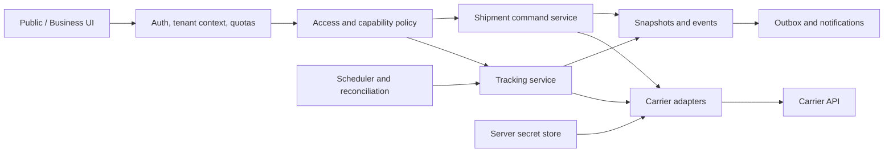

# Delivery: база знань уніфікованої системи доставки

Дата: 2026-10-07. Версія: 0.1. Статус: архітектурна база та план, не реалізований API чи міграція.

## 1. Рішення та межі погодження

Погоджений напрямок: почати реальний пілот із Нової пошти; Укрпошта наступна, якщо доступ дозволяє. Перший пріоритет — трекінг існуючих накладних без окремого ключа кожного клієнта, через один дозволений ключ сервісу або офіційний безключовий доступ. Створення відправлення під credentials клієнта — наступний окремий етап.

Поточне завдання — зафіксувати модель і план. Погодження пілоту не є дозволом створювати реальні накладні, замовляти платні послуги, змінювати відправлення чи розгортати production. Без ключа/підтверджених умов та дозволених тестових номерів живе підключення не вважається перевіреним.

Цей документ уточнює пріоритети [плану запуску](DELIVERY_LIVE_TRACKING_PLAN.md), зберігаючи модель статусів із [початкової специфікації](SHIPMENT_TRACKING_SERVICE_SPEC.md). Правила нижче є пропозицією контракту, а не твердженням про вже наявні endpoints.

## 2. Два режими, одне ядро

| Властивість | A: трекінг існуючого відправлення | B: створення та супровід |
| --- | --- | --- |
| Вхід | Номер накладної, відомий перевізник або кандидат | Відправник, одержувач, маршрут, місця, послуга, умови оплати доставки |
| Credentials | Пріоритет: service credential; безключовий доступ, якщо дозволений; tenant credential лише коли потрібно | Підключення конкретного клієнта до конкретного рахунку/договору перевізника |
| Побічна дія | Lookup або локальна підписка на моніторинг; не створює ТТН | Зовнішня команда, яка може створити договірне/платне зобов'язання |
| Мінімальна приватність | Статус, час, безпечна локація, freshness | Персональні адреси, контакти, документи; тільки авторизований бізнес-доступ |
| Джерело походження | `external_import` | `platform_created` |
| Спільна частина | Shipment, references, snapshot, events, scheduler, notifications | Після успішного створення використовує той самий tracking pipeline |

Імпортований номер не підтверджує володіння фізичним відправленням і не дає права змінювати його. Перехід A → B не означає повторно створити ту саму ТТН: управління існуючою накладною вмикається лише після окремої перевірки прав і підтримки API.

## 3. Доступ без ключів кожного клієнта

### 3.1. Політики доступу

| `access_policy` | Призначення | Обмеження |
| --- | --- | --- |
| `public_no_key` | Офіційно дозволений мінімальний трекінг без credentials | Не scraping, не обхід валідації, не гарантована доступність персональних полів |
| `service_shared` | Один обліковий запис нашого сервісу для дозволених номерів різних клієнтів | Потрібні підтверджені scope/умови перевізника; спільна квота та ізольовані tenant-дані |
| `tenant_delegated` | Ключ конкретного бізнес-клієнта | Читання розширених даних і майбутні команди в межах його договору |

Для MVP обираємо Нову пошту та намагаємося підтвердити `service_shared`; `public_no_key` оцінюємо лише як документований обмежений варіант. Якщо право або технічний scope не підтверджені, не оголошуємо спільний трекінг доступним. Пропонуємо окреме підключення, офіційне посилання або чесний `unsupported`/`needs_verification`.

Не перемикати запит із відхиленого клієнтського ключа на більш привілейований сервісний. Не перебирати ключі, телефони чи облікові записи для обходу доступу/квот. Credentials обирає серверна policy, а не параметр браузера.

### 3.2. Що відомо про перші дві служби

| Питання | Нова пошта API v2.0 | Укрпошта |
| --- | --- | --- |
| Документований трекінг | `getStatusDocuments`; до 100 документів у пакеті | Окремий сервіс статус-трекінгу за штрихкодом |
| Без ключа | Опис допускає обмежені неавторизовані запити | Не підтверджено |
| Один ключ для різних клієнтів | Технічну поведінку й договірний дозвіл для нашого сервісу ще потрібно підтвердити | Окремий tracking key через перевізника; агрегаторський scope потрібно погодити |
| Розширені дані | Ключ і валідація; `Phone` впливає на доступні дані | Залежить від конкретного API і credentials, не прирівнювати до статус-трекінгу |
| Створення | Окремі методи експрес-накладних; підключення клієнта | Окремий API оформлення, `bearer`/`token`; не підміняти tracking key |
| Історія | Повнота історії поточним методом не доведена | Перевірити актуальний PDF та реальний дозволений response |

У Нової пошти текст сторінки називає `TrackingDocument`, приклад — `TrackingDocumentGeneral`. Вибір моделі фіксується в адаптері після контрольної перевірки. Не закладати цю розбіжність у загальну модель.

Документація також описує підміну контактних даних для неавторизованого запиту даними номера телефону із запиту. Такі поля не можуть підтверджувати особу відправника/одержувача. У режимі A не запитуємо телефон без необхідного погодженого сценарію й не показуємо контакти, суми післяплати або адресу квартири.

### 3.3. Перевірка перед увімкненням спільного ключа

1. Погодити з перевізником статус сервісу-агрегатора, дозволені поля, кешування, показ третім особам, квоти та термін зберігання.
2. Отримати дозволені тестові накладні щонайменше двох незалежних клієнтів. Використати саме один сервісний credential, перевірити мінімальний трекінг без їхніх ключів і телефонів.
3. Зіставити результат з офіційним кабінетом; зберегти лише знеособлені fixtures. Окремо перевірити відмову, незнайдений номер, 429, timeout, логічну помилку при HTTP 200.
4. Зафіксувати outcome: `verified_service_shared`, `verified_public_limited`, `tenant_only` або `blocked_pending_provider`. Технічний успіх не замінює договірного дозволу.

## 4. Структура системи

Ядро володіє tenant-правами, ідемпотентністю, чергами, збереженням, нормалізованими статусами та підписками. Адаптер володіє авторизацією конкретного API, форматами запиту/відповіді, кодами, одиницями, довідниками та обмеженнями.
UI отримує capabilities і правила валідації, але не секрети й не довільні raw payload перевізника.

## 5. Спільний словник даних

Це логічні сутності, не готова SQL-схема. Усі tenant-залежні посилання перевіряються в межах тієї самої організації.

| Сутність | Основні дані | Інваріант |
| --- | --- | --- |
| `CarrierProduct` | carrier, product, API version, adapter version | Нова пошта v2.0 та Nova Post v.1.0 — різні API-продукти |
| `CredentialBinding` | id, owner kind service/tenant, tenant id коли потрібно, provider account ref, environment, secret ref/version, scopes, state | Секрет поза прикладною БД; кілька bindings на tenant/carrier дозволені |
| `Shipment` | id, tenant id, origin, carrier product, revision, delivery status, monitoring policy | Tenant володіє локальним записом, не обов'язково має право керувати накладною |
| `ShipmentReference` | carrier, tracking number, provider document id, cycle, role, leg/piece ref | Tracking number — рядок; не UUID і не глобальний первинний ключ |
| `TrackingSnapshot` | status, reason, ETA, safe location, last checked/success, tracking state, freshness | Збій джерела не стирає останній успішний стан |
| `TrackingEvent` | source id/code/text, normalized status, occurred/received time, timezone certainty, mapping version, leg/piece, correction | Зберігаємо походження; дубль не створює повторне сповіщення |
| `MonitoringSubscription` | tenant/user, shipment, scope, channels, consent, expiry | Окрема від одноразового lookup; відкликання не видаляє чужі підписки |
| `Party` | role, business/person, display name, verified contacts, provider refs | Персональні дані режиму B, не обов'язкові для A |
| `Location` | country, postal code, locality, street/house/unit або point ref, geo, provider refs | Ідентифікатор відділення не взаємозамінний із поштовим індексом |
| `ParcelPiece` | id, weight grams, dimensions mm, description, declared value | Багатомісність зберігається, не згортається до одного місця |
| `ServiceSelection` | pickup/delivery mode, provider service code, payer, options | Семантично різні продукти не маскуємо однаковою назвою |
| `ShipmentDraft` | parties, route, pieces, service, quote ref, validation revision | Чернетка ще не Shipment перевізника і може не мати номера |
| `CarrierOperation` | type, binding id, idempotency/request hash, state, attempts, provider refs, audit | Невідомий результат команди не дорівнює відмові |
| `DocumentArtifact` | label/manifest type, provider ref, storage ref, expiry, format | Доступ авторизований; не постійний публічний URL із персональними даними |

Нормалізація номера прибирає лише дозволені зайві символи: не видаляти початкові нулі й не приводити до числа. Формат S10 не доводить належність Укрпошті. Дедуплікація має враховувати tenant, API-продукт, підтверджений номер/ідентифікатор та реальний цикл; дата імпорту не доводить початок нового циклу.

## 6. Відповідність схожих полів

| Канонічне поле | Нова пошта | Укрпошта | Правило уніфікації |
| --- | --- | --- | --- |
| `tracking_number` | `DocumentNumber` у запиті, `Number` у відповіді трекінгу | Штрихкод; точну назву поля звірити з контрактом | Рядок та окремі provider document refs |
| `raw_status_code` | `StatusCode` | Код події/статусу; точне поле після перевірки PDF | Не порівнювати числові коди між службами |
| `delivery_status` | Версіонований mapping коду | Незалежний mapping коду | Єдиний enum ядра, невідоме значення не стає delivered |
| `destination_point` | Provider ref/номер відділення, адреса з довідника | Індекс/ідентифікатор точки згідно з API | Namespace перевізника + snapshot адреси |
| `sender` / `recipient` | Контрагенти/контактні особи в API оформлення | Сутності клієнта/адреси за API оформлення | Party + scoped provider refs; не копіювати refs між accounts |
| `weight` / `dimensions` | Одиниці залежать від методу | Одиниці звірити з методом/послугою | Усередині g/mm; адаптер явно конвертує і перевіряє округлення |
| `money` | Валюта та сума за контрактом послуги | Валюта та сума за контрактом послуги | Currency + integer minor units; не float, не припускати 2 знаки для всіх валют |
| `event_time` | Дата джерела, інколи лише snapshot | Дата джерела за контрактом | Оригінальне значення + UTC коли timezone відомий; не вигадувати точність |

Поля Укрпошти, які ще не перевірені, навмисно не названі точними JSON-ключами. Остаточні mappings оформлюються адаптерними fixtures, а не здогадками в загальному DTO.
Специфічні опції зберігаються у валідованому namespaced `provider_options`; це не довільний passthrough JSON від браузера.

## 7. Незалежні стани

`delivery_status` і `tracking_state` використовують чинний словник розділу 7 початкової специфікації. Додаткових синонімів на кшталт source_unavailable замість `provider_unavailable` не створюємо.

- Фізична доставка: `label_created`, `accepted`, `in_transit`, `ready_for_pickup`, `out_for_delivery`, `delivered`, повернення та винятки за словником.
- Отримання даних: `pending`, `active`, `needs_verification`, `not_found`, `rate_limited`, `provider_unavailable`, `access_denied` тощо.
- Свіжість: `fresh`, `stale`, `never_checked`; окремі `last_checked_at` і `last_success_at`.
- Майбутня команда: `queued`, `running`, `succeeded`, `failed`, `outcome_unknown`, `reconciling`. Успішний create означає створення документа, не фізичне прийняття посилки.

`occurred_at` події відрізняється від часу першого спостереження. Якщо доступний лише snapshot, UI показує «зафіксовано сервісом», не вигадану повну історію до імпорту.
Вручення, сплата доставки, отримання післяплати й зарахування продавцю — різні факти. Жодний tracking event не змінює стан платіжного рахунку.

## 8. Контракт адаптера та capabilities

Обов'язкові для першого режиму: `detectHints`, `track`; опційні: `trackBatch`, `listPoints`, `getHistory`. Пізніше: `validateDraft`, `quote`, `createShipment`, `getOperationResult`, `getDocuments`, `cancelShipment`, `updateShipment`, `requestPickup`, `requestReturn`, `redirectShipment`.

Єдина обгортка результату: `data`, `warnings`, `source`, `observed_at`, `schema_version`; помилка: `code`, `retryable`, `retry_after`, `safe_message`, внутрішній знеособлений provider error ref. `outcome_unknown` обов'язковий для неоднозначних результатів команд.

Capability визначається комбінацією carrier product + environment + account scope + service + поточний shipment state. Значення: `supported`, `unsupported`, `unverified`, додатково `enabled`. Недостатньо одного глобального boolean на перевізника.
Приклад: `track.public_minimal`, `track.history`, `points.lockers`, `create.domestic`, `documents.label`, `cancel.before_acceptance`. Непідтверджена capability не активує кнопку.

Ліміти є конфігурацією: batch size, account rate, max pieces, weight, dimensions, supported currencies/countries. До 100 документів у запиті Нової пошти не означає 100 requests/minute.

## 9. Безпечний workflow створення на наступному етапі

Чернетка → перевірка account/scopes → валідація довідників і даних → розрахунок/оцінка тарифу → підтвердження користувачем → create operation → документ/номер → той самий моніторинг, що й режим A.

Перед створенням фіксуються користувач, tenant, конкретне підключення, environment, hash чернетки та idempotency key. Зміна суттєвих полів після підтвердження вимагає нової валідації; quote має timestamp/expiry і не завжди гарантує остаточну ціну.
Повтор того самого ключа з іншим payload — конфлікт. Якщо запит міг створити ТТН, але response втрачений, не повторювати create автоматично: `outcome_unknown` → пошук/звірка за підтримуваним provider ref → ручне вирішення, якщо кореляція ненадійна. Власна idempotency-таблиця не робить зовнішній API exactly-once.

Друк етикетки не означає замовлення кур'єра. Видалення документа до передачі не дорівнює скасуванню фізичної доставки. Переадресація, повернення, редагування і pickup — окремі capabilities/команди з підтвердженням, аудитом та можливими витратами. «Весь цикл» означає прозорий супровід дозволених операцій, а не автоматичне виконання всіх доступних дій.

## 10. Приватність, кеш і спільна квота

Один сервісний ключ зберігається тільки на сервері, має окрему dev/prod конфігурацію, ротацію та аварійне вимкнення. Його відмова впливає на всіх користувачів, тому потрібні health status і контроль черги.
Tenant records, subscriptions, audit і user notes завжди ізольовані. Не використовувати спільний ключ як спільну ідентичність клієнтів.

За замовчуванням кеш ізольований за tenant/access scope та credential identity. Спільний кеш дозволений лише для явно схваленої мінімальної неперсональної проєкції; ключ включає API-продукт, номер, цикл і версію policy. Привілейовані відповіді з телефонною валідацією/tenant key ніколи не потрапляють у публічний кеш. Не повертати raw response.
Номер ТТН не є секретом авторизації. Для бізнес-деталей потрібне членство/права; для share link — обмежений відкличний capability. Для public lookup: rate limits, захист від перебирання, мінімальні поля та короткий TTL.

Scheduler має спільний ліміт provider account і справедливі tenant-квоти, batching і jitter; один клієнт не повинен зайняти весь ключ. Retry 429/timeout не маскується під not_found. Одноразовий lookup не породжує безстрокову підписку.

## 11. Поетапний план

| Етап | Робота | Умова завершення |
| --- | --- | --- |
| A0: право й контракт | Погодити shared access Нової пошти; отримати один серверний ключ і дозволені номери різних клієнтів | Підтверджені scope/квоти/мінімальні поля та результат контрольної перевірки |
| A1: Нова пошта lookup | Access policy, adapter, DTO, mapping, помилки, safe response, tenant/rate protection | Реальні дозволені ТТН перевіряються без ключів кожного клієнта; або явно зафіксовано неможливість такого режиму |
| A2: моніторинг | Persistence, jobs, leases, дедуплікація, snapshots/events, freshness, підписки | Оновлення переживають перезапуск, відмови чесно видимі, дані клієнтів ізольовані |
| A3: Укрпошта | Погодити shared tracking key; перевірити API; другий адаптер на тих самих контрактах | Немає нового provider-specific ядра/UI; відмінності описані capabilities/mapping |
| B0: підготовка команд | Підключення клієнтів, scopes, drafts, account-specific refs, validation, permissions | Безпечна чернетка без реального create; погоджений перелік команд і витрат |
| B1: створення НП | Quote/confirm/create/reconcile/documents, приєднання до спільного tracking | Немає дубля при повторі/timeout; отриманий номер відстежується ядром A |
| B2: супровід і Укрпошта | Дозволені update/cancel/pickup/return, другий write adapter | Кожна capability перевірена окремо; не підтримувані дії чесно недоступні |

Укрпошта не блокує перший пілот Нової пошти. Режим B не блокує A. Публікація сервісу й реальні write-команди погоджуються окремо.

## 12. Зміни щодо наявного scaffold

- [Схема](../apps/delivery/src/lib/server/db/schema.ts): `carrierConnections` зараз унікальна за tenant/carrier; запропонована модель потребує binding ID, owner/scope/environment/account і кількох підключень. Не створювати фіктивний tenant для сервісного ключа.
- [Detector](../apps/delivery/src/lib/server/services/detector.ts): формат дає кандидата, а не confirmed carrier; S10 неоднозначний.
- [POST shipments](../apps/delivery/src/routes/api/v1/shipments/+server.ts): прибрати placeholder tenant/auth у майбутній реалізації; не використовувати цей endpoint для зовнішнього create. Реєстрація локального моніторингу та створення накладної — різні команди.
- Поточний `trackingCycle` за датою імпорту не є надійною ідентичністю життєвого циклу. Потрібна явна стратегія повторного використання номерів і reconciliation.
- Публічні/бізнес-сторінки зараз демонстраційні. Розробляти DTO на backend; не дублювати provider mappings у Svelte.

Усе це заплановані зміни, не застосовані міграції. Доступ до Dashboard, його auth чи фінансових процесів не змінюється.

## 13. Перевірки та підтримка бази знань

Контрактні тести: знеособлені fixtures перевізника → canonical DTO, незнайдений номер, новий raw code, неповна відповідь, відсутній event time, 401/403/429/timeout, HTTP 200 з логічною помилкою.
Ізоляція: той самий номер у двох tenants, окремі підписки; privileged lookup не потрапляє в public cache; браузер не може обрати чуже binding; відключення одного tenant не скасовує моніторинг іншого.
Команди B: повтор ключа, інший payload, зникла відповідь після create, відкликання credentials, застаріла чернетка, provider rejection, недозволений cancel, часткова готовність документів.

Для кожного адаптера підтримувати в цій базі або пов'язаній контрактній специфікації: API-продукт/версію, URL джерела, дату перевірки, доступні scopes, ліміти, поля й одиниці, mapping version, історію, ідемпотентність/повтори, permission rules, verified capabilities і відкриті питання. Секрети та реальні персональні дані в документацію не додавати.

Наступні вхідні дані від власника проєкту: сервісний обліковий запис Нової пошти, відповідь щодо агрегаторського доступу, дозволений набір тестових накладних, очікувані обсяги та інтервал свіжості. Секрет вводиться безпосередньо у server-only secret store, не в чат.

## 14. Офіційні джерела й рівень впевненості

- [Нова пошта: getStatusDocuments](https://developers.novaposhta.ua/view/model/a99d2f28-8512-11ec-8ced-005056b2dbe1/method/a9ae7bc9-8512-11ec-8ced-005056b2dbe1): прочитано опис, request/response fields; live не перевірено.
- [Нова пошта: ліцензійна угода API](https://static.novaposhta.ua/sitecard/misc/doc/API_license_agreement.pdf): джерело для погодження умов; дозвіл нашому агрегатору не встановлено.
- [Нова пошта: створення експрес-накладної](https://developers.novaposhta.ua/view/model/a90d323c-8512-11ec-8ced-005056b2dbe1/method/a965630e-8512-11ec-8ced-005056b2dbe1): метод знайдено в офіційному каталозі; повний write-контракт потребує окремого аналізу на B0.
- [Укрпошта: FAQ](https://dev.ukrposhta.ua/faq) і [актуальна документація](https://dev.ukrposhta.ua/documentation): tracking та оформлення є окремими продуктами доступу.
- [Укрпошта: статус-трекінг](https://dev.ukrposhta.ua/uploads/Status-tracking-API-04032026.pdf), [відправлення по Україні](https://dev.ukrposhta.ua/uploads/API_documentation_02092026_ua.pdf), [початок роботи](https://dev.ukrposhta.ua/uploads/how-to-use-api-11022026.pdf): офіційні посилання підтверджені; точні поля PDF ще не перевірені.

Підтвердження документацією, технічний live-тест і договірний дозвіл — три окремі перевірки. Поки жодний перевізник не позначений як live verified у нашій системі.