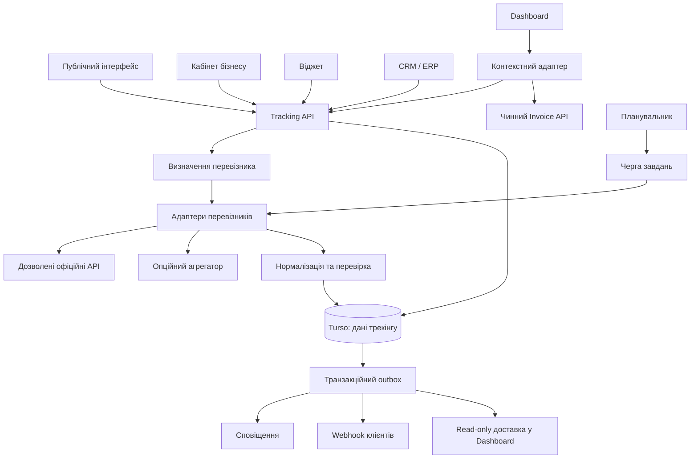

# Агрегатор-помічник з відстеження відправлень

Продуктова, бізнесова та технічна специфікація автономного сервісу, API, віджета й модуля Dashboard.

Дата: 2026-10-06. Версія: 0.1. Статус: **концепція для погодження, не реалізований і не розгорнутий сервіс**.

Робоча назва: **Rahunok Tracking**. Назва не є рішенням щодо бренду або домену.

## 1. Резюме та головне рішення

Створити незалежний сервіс видимості доставки для України: покупець вводить номер накладної, сервіс намагається визначити перевізника, показує зрозумілий статус, місце отримання та повідомляє про важливі зміни. Бізнес отримує єдину операційну панель, API та події, не інтегруючись із кожним перевізником окремо.

Продукт працює у чотирьох формах на одному ядрі:

1. **Самостійний сервіс:** публічний пошук і особистий список відправлень; окремий кабінет компанії.
2. **Enterprise API:** підключення CRM, ERP, OMS, маркетплейсів, контакт-центрів та логістичних платформ.
3. **Віджет:** вбудований трекінг або вибір точки отримання на сторонньому сайті.
4. **Модуль Dashboard:** доставка поряд з уже створеним рахунком; рахунок не є обов'язковим для існування відправлення.

**Рекомендація:** власні адаптери офіційних API українських перевізників, Turso для даних трекінгу, фонове оновлення та нормалізовані події. 17TRACK або AfterShip залишити опційними провайдерами для непокритих напрямків і порівняльного пілоту, а не обов'язковою безкоштовною основою.

Початкова ціннісна пропозиція:

> Введіть номер накладної. Ми визначимо доступного перевізника, покажемо перебіг доставки й повідомимо, коли відправлення можна забрати. Якщо номер неоднозначний або джерело недоступне, чесно пояснимо наступний крок.

Не обіцяти «будь-який номер, усі перевізники, завжди безкоштовно, миттєво й без жодних ключів». Простота для продавця досягається роботою платформи з доступами, договорами, лімітами та якістю даних.

## 2. Межі цього документа

- Усі API, таблиці, екрани, інтервали та SLO нижче є **запропонованими контрактами**, а не описом готових можливостей репозиторію.
- Документ не дозволяє змінювати Dashboard, Pay, Merchant App, платіжні статуси, SQL, авторизацію чи production.
- Сценарії `fixed`, `open_amount`, `table`, `delivery` залишаються заблокованими відповідно до [реєстру процесів](DASHBOARD_PROCESS_REGISTRY.md). Відомий production-блокер persistence сценарію `delivery` не знімається трекінгом.
- Майбутній адаптер може зачепити рахунки, авторизацію, оболонку, налаштування та `CROSS-APP-INVOICE-SCENARIOS-001`. Точні ідентифікатори решти процесів та їхні інваріанти потрібно встановити за реєстром перед реалізацією, без автоматичного розблокування.
- Не проводився аудит чинної реалізації цих процесів або remote-схем. Реєстр не змінюється: ця концепція не є новим прийнятим процесом.
- Приклади номерів і відповідей синтетичні, не є перевіркою реального відправлення. Приклади не слід надсилати перевізникам.

## 3. Погляд споживача, бізнесу та оператора

| Учасник                  | Потреба                                | Цінність сервісу                                                  | Ознака успіху                                        |
| ------------------------ | -------------------------------------- | ----------------------------------------------------------------- | ---------------------------------------------------- |
| Покупець                 | Де посилка і що робити далі?           | Один пошук, історія, точка отримання, повідомлення                | Отримує відповідь без дзвінка продавцю               |
| Продавець малого бізнесу | Не перевіряти десятки накладних вручну | Єдиний список, нагадування про незабрані посилки                  | Менше звернень «де замовлення?»                      |
| Оператор підтримки       | Швидко пояснити затримку               | Події, джерело, час останньої перевірки, готове посилання клієнту | Менший час обробки звернення                         |
| Логіст                   | Знайти проблеми, а не читати всі рядки | Черга винятків, фільтри, масові операції, відповідальні           | Менше непомічених затримок і повернень               |
| Фінансист                | Бачити доставку поряд з оплатою        | Два незалежні стани та список розбіжностей                        | Немає хибних підтверджень зарахування                |
| Розробник інтеграції     | Один передбачуваний контракт           | API, webhook, sandbox, версії, ідемпотентність                    | Інтеграція без знання кодів усіх перевізників        |
| Enterprise-адміністратор | Керований доступ і відповідальність    | Організації, ролі, аудит, квоти, політики зберігання              | Пройдена перевірка ізоляції й операційної готовності |
| Оператор платформи       | Контроль витрат та збоїв               | Метрики адаптерів, бюджет, повтори, dead-letter                   | Відмова одного джерела не зупиняє продукт            |

### 3.1. Що беремо з референсу vidstezhyty.com.ua

Беремо патерн «одне поле, одна дія, зрозумілий результат» та видимість кількох перевізників. Не копіюємо контент, дизайн, базу даних або внутрішні запити сайту.

Enterprise-відмінність: авторизовані робочі простори, масове завантаження, контроль SLA джерел, зв'язок із замовленнями, розмежування доступів, експорт, API, журнал подій та гарантовано відновлювана обробка.

Референс містить історичні відомості, зокрема про Justin і строки доставки станом на 2022 рік. Це не підтвердження поточного покриття, мережі відділень або працездатності API.

### 3.2. Що не входить у перший продукт

Створення ТТН, купівля доставки, виклик кур'єра, переадресація, зміна одержувача, оформлення претензій від імені клієнта, керування післяплатою, escrow, повернення грошей та рух коштів. Для таких операцій потрібні окремі дозволи й контракти.

«Помічник» у MVP означає правила та зрозумілі наступні дії, а не LLM. Визначення перевізника, статуси й рішення про оплату не повинні залежати від генеративної відповіді.

## 4. Перевізники та реалістична модель доступу

### 4.1. Матриця запуску

| Перевізник           | Запропонований код | Роль                | Що перевірено / що невідомо                                                                                                     | Умова активації                                                                                             |
| -------------------- | ------------------ | ------------------- | ------------------------------------------------------------------------------------------------------------------------------- | ----------------------------------------------------------------------------------------------------------- |
| Нова пошта           | `nova_poshta`      | Перший кандидат MVP | Відомий офіційний портал розробників; його зміст не вдалося витягти під час підготовки                                          | Офіційний доступ, дозволений tracking scope, перевірка обмежень без телефону, довідників і квот             |
| Укрпошта             | `ukrposhta`        | Другий кандидат MVP | Сторінку API не вдалося змістовно перевірити через перенаправлення                                                              | Підтверджена документація й авторизація саме tracking API, а не лише API оформлення                         |
| Meest / Міст Експрес | `meest`            | Наступна черга      | Потрібно уточнити продукт: внутрішня доставка, міжнародна мережа, last mile; сторінка API не підтвердила контракт               | Затверджений набір сервісів, їхніх ідентифікаторів та прав на дані                                          |
| SAT                  | `sat`              | Вантажний B2B       | Офіційний сайт має трекінг, пошук відділень і бот; це не доказ відкритого API                                                   | Документований API/партнерський канал, квоти й право на автоматичне відстеження                             |
| Delivery             | `delivery`         | Вантажний B2B       | Офіційний сайт наданий; API-контракт і тарифи в цій перевірці не встановлені                                                    | Підтверджена документація для накладних, подій, складів і багатомісних вантажів                             |
| Justin               | `justin`           | Історичні дані      | Згадується в застарілому референсі; поточну діяльність та доступність API авторитетним джерелом у цій перевірці не підтверджено | За замовчуванням `inactive`; архів за наявності законно отриманих даних, активація лише після підтвердження |

Покриття релізу визначається прийнятими адаптерами, а не переліком логотипів. Неактивний перевізник не повинен удавати успішний пошук.

### 4.2. Три допустимі моделі

1. **Платформний доступ:** сервіс має власний офіційний обліковий запис/договір. Продавець передає лише номер. Можливість перевіряти чужі накладні та передавати результати третім сторонам має бути прямо дозволена.
2. **Делегований доступ продавця:** потрібен для закритих відправлень або розширених даних. Підключається добровільно; не є прихованою вимогою після реклами «без ключа».
3. **Агрегатор:** сервіс оплачує чи використовує дозволену пробну квоту 17TRACK/AfterShip. Потрібні платформний ключ, перевірка українського покриття, умов перепродажу та обробки персональних даних.

**Відсутність ключа продавця не дорівнює відсутності авторизації платформи.** Власний ключ також не дає автоматичного права на будь-які накладні. Телефон або інший додатковий атрибут запитується лише коли це документована вимога конкретної можливості; він не виводиться з інших джерел.

Заборонені основи продукту: обхід авторизації, CAPTCHA, лімітів, використання чужих ключів, скрейпінг кабінетів, недокументованих приватних endpoint або автоматизація публічної форми без дозволу.

### 4.3. Оцінка варіантів

| Критерій           | Власні офіційні адаптери                                                         | 17TRACK / AfterShip                                           |
| ------------------ | -------------------------------------------------------------------------------- | ------------------------------------------------------------- |
| Старт              | Більше інтеграційної роботи                                                      | Один контракт, але перевірка покриття залишається             |
| Витрати            | Потенційно без окремої плати за API; умови кожного перевізника треба підтвердити | Комерційні API, trial не означає безлімітний free tier        |
| Контроль           | Власні статуси, історія та політики                                              | Залежність від моделі й оновлень агрегатора                   |
| Відділення         | Окремий офіційний довідник кожного перевізника                                   | Tracking API не обов'язково містить довідник точок            |
| Українські вантажі | Можна врахувати місця, склади, документи                                         | Потрібні реальні кейси SAT/Delivery, не лише назва в каталозі |
| Відмовостійкість   | Перевізники незалежні; супровід на нас                                           | Ще одна центральна залежність                                 |

На 2026-10-06 сторінка 17TRACK показує trial та платні пакети, зокрема 5 000 quota за $119 із валідністю плану 12 місяців. Семантику quota, повторну реєстрацію та всі доплати потрібно погодити. AfterShip показує платні плани, а API/webhooks зазначені в Premium. Це не безкоштовні production-залежності.

## 5. Основні користувацькі сценарії

### 5.1. Простий разовий трекінг

1. Користувач вставляє номер або сканує штрихкод за дозволом на камеру.
2. Система прибирає лише дозволені пробіли/розділювачі, зберігаючи нулі на початку; номер завжди рядок.
3. Локальні правила формують кандидатів; backend перевіряє дозволене джерело.
4. Якщо перевізника підтверджено, показуються статус, історія, час перевірки та точка отримання, якщо вона відома.
5. Якщо кандидатів кілька, користувач бачить їх і може обрати; вибір не підміняє перевірку.
6. Після результату доступні «Повідомити про зміни», «Зберегти», «Відкрити у перевізника».

Разовий запит не запускає безстроковий polling. Тимчасовий lookup має короткий TTL; постійний моніторинг створюється після явної дії та відповідного права доступу.

### 5.2. Найближча точка

Людина обирає перевізника/тип точки, дозволяє геолокацію або вводить населений пункт. Сервіс показує найближчі придатні точки, адресу, робочий час, обмеження ваги й габаритів, дату оновлення довідника та маршрут у зовнішній карті.

**Найближча точка не означає точку видачі конкретної посилки.** Для вже оформленої накладної пріоритет має призначене перевізником місце. Пошук іншого відділення не змінює доставку; переадресація відбувається тільки в окремому офіційному процесі.

### 5.3. Підписка одержувача

Користувач обирає події та канал, підтверджує адресу/підключення. Повідомлення про прибуття містить статус, безпечне посилання, адресу відділення та строк зберігання лише коли джерело його передало. У кожному каналі є відписка.

### 5.4. Робоче місце продавця

Продавець додає одну ТТН, вставляє список або імпортує CSV. Система показує помилки по рядках до підтвердження, прибирає дублікати в межах організації, приймає валідні записи незалежно від невалідних. Теги, номер замовлення, відповідальний та зв'язок із рахунком є додатковими полями.

### 5.5. Зв'язок із рахунком Dashboard

У деталях уже існуючого рахунку продавець обирає «Додати відправлення». Backend перевіряє доступ до рахунку й організації, створює зв'язок у сервісі трекінгу та показує окремий блок доставки. Відсутність ТТН не блокує створення або оплату рахунку.

Один рахунок може мати кілька відправлень: часткове відвантаження, кілька місць або окреме повернення. MVP не об'єднує кілька рахунків в одне відправлення: така консолідація потребує окремого правила.

### 5.6. Обробка винятку

Якщо посилка затрималась, оператор отримує задачу, а не хибний статус «втрачено». У задачі є причина, відомий стан, свіжість даних, відповідальний і наступна дія. Відмова API створює технічне попередження, а не проблему доставки.

### 5.7. Enterprise-інтеграція

ERP реєструє відправлення з `external_reference`, отримує `shipment_id`, приймає підписані webhook і періодично звіряє snapshot через API. Повторні події не створюють повторних задач. Клієнт може відновити події після збою за курсором або журналом доставок.

## 6. Визначення перевізника

### 6.1. Алгоритм

1. Валідація довжини, допустимих символів та контрольної суми лише для форматів, де вона документована.
2. Перевірка на відомий tracking ID у поточному tenant і дозволеному credential scope.
3. Генерація кандидатів за версійованими правилами формату, підказкою клієнта, країною й контекстом інтеграції.
4. Відсікання неактивних та недоступних адаптерів.
5. Обмежені перевірки кандидатів: стартово не більше двох на lookup, із загальним бюджетом часу, rate limit і квотою платформи.
6. Підтвердження за валідною відповіддю джерела з відповідним номером і достатніми атрибутами, а не за HTTP 200.
7. Повернення `confirmed`, `ambiguous`, `unresolved` або `unsupported` разом із підставою.

14 цифр є підказкою для Нової пошти, 13 цифр для Укрпошти, але не доказом. Формат UPU S10 не визначає однозначно поточного last-mile перевізника. Історичні 9-значні формати SAT/Justin можуть перетинатися. Ці приклади не є затвердженим набором regex.

### 6.2. Правила довіри

- `carrier_hint` змінює порядок кандидатів, але не надає права доступу й не доводить існування відправлення.
- `confidence` у MVP є категорією `low/medium/high`, а не вигаданим відсотком точності.
- Якщо два джерела повернули збіг, не змішуємо історії автоматично. Просимо уточнення або створюємо перевірений зв'язок між етапами доставки.
- Не перебираємо всіх перевізників для кожного номера: це витрати, витік ідентифікатора та ризик блокування.
- Зміна перевізника після підтвердження вимагає повторної перевірки й аудиту; старі події зберігають початкове походження.
- Передача між міжнародним і українським оператором моделюється окремими `shipment_legs`, а не перезаписом історії.
- Номер може використовуватись повторно. Нова відправка після завершеної історії є новим `tracking_cycle`, а не продовженням старого запису.

## 7. Статуси та їхня семантика

### 7.1. Доставка: `delivery_status`

| Код                       | Текст для людини          | Точне значення                                      |
| ------------------------- | ------------------------- | --------------------------------------------------- |
| `unknown`                 | Статус уточнюється        | Ще немає достатніх підтверджених даних              |
| `label_created`           | Накладну створено         | Фізичне прийняття перевізником не підтверджене      |
| `accepted`                | Прийнято перевізником     | Є підтверджена подія прийняття                      |
| `in_transit`              | У дорозі                  | Переміщення або сортування                          |
| `customs`                 | Митне оформлення          | Застосовується до відповідного міжнародного етапу   |
| `ready_for_pickup`        | Можна забирати            | Прибуло до точки видачі, але ще не вручено          |
| `out_for_delivery`        | Передано кур'єру          | Останній етап доставки до адреси                    |
| `delivered`               | Вручено одержувачу        | Джерело явно підтвердило вручення                   |
| `delivery_attempt_failed` | Спроба вручення неуспішна | Можливі повторна спроба або видача у відділенні     |
| `refused`                 | Одержувач відмовився      | Не означає, що вже повернуто відправнику            |
| `return_in_transit`       | Повертається              | Повернення розпочато                                |
| `returned`                | Повернуто відправнику     | Є підтвердження завершеного повернення              |
| `cancelled`               | Відправлення скасовано    | Лише явна подія перевізника                         |
| `lost`                    | Втрату підтверджено       | Лише явне підтвердження джерела, не таймер          |
| `damaged`                 | Пошкодження підтверджено  | Лише явне повідомлення джерела                      |
| `exception`               | Потрібне уточнення        | Інша документована проблема; деталь у `reason_code` |

Затримка, близький кінець зберігання, проблемний напрямок і потреба уваги є окремими `attention_flags`, а не заміною основного статусу. Невідомий новий код перевізника зберігається, створює сигнал адаптеру та не перетворюється на `delivered`.

### 7.2. Отримання даних: `tracking_state`

| Код                    | Поведінка                                                    |
| ---------------------- | ------------------------------------------------------------ |
| `pending`              | Першу перевірку поставлено в чергу                           |
| `active`               | Моніторинг працює; свіжість визначається окремими timestamps |
| `needs_carrier`        | Потрібне уточнення перевізника                               |
| `needs_verification`   | Потрібні дозволені додаткові дані/підтвердження права        |
| `not_found`            | Джерело поки не знаходить накладну; це не скасування         |
| `rate_limited`         | Вичерпано ліміт; відома наступна дозволена спроба            |
| `provider_unavailable` | Джерело тимчасово недоступне                                 |
| `access_denied`        | Доступ не дозволений або credentials недійсні                |
| `unsupported`          | Немає дозволеного активного адаптера                         |
| `paused`               | Моніторинг призупинено користувачем/політикою                |
| `completed`            | Регулярний моніторинг завершено за політикою                 |
| `expired`              | Закінчилось вікно моніторингу, результат доставки невідомий  |

`freshness` обчислюється як `fresh/stale/never_checked` за останнім успішним отриманням і політикою конкретного статусу. Збій не стирає останній підтверджений стан доставки. `expired` не означає втрату, повернення чи вручення.

### 7.3. Оплата: окремий зовнішній факт

Платіжний сервіс залишається єдиним джерелом стану рахунку. Його фактичні enum не змінюються цим документом. Трекінг може відображати read-only проєкцію разом із `payment_observed_at`, але не записує платіжні переходи.

| Доставка         | Факт оплати                     | Дія помічника                                                      |
| ---------------- | ------------------------------- | ------------------------------------------------------------------ |
| Вручено          | Підтверджено платіжним джерелом | Показати завершення двох незалежних процесів                       |
| Вручено          | Не підтверджено                 | Задача на звірку; не позначати автоматично `paid`                  |
| Повернуто        | Оплачено                        | Задача на перевірку повернення коштів; не виконувати refund        |
| Можна забирати   | Не оплачено                     | Показати погоджене посилання на рахунок лише за правилами продавця |
| Статус невідомий | Оплачено                        | Зберегти оплату; пояснити недоступність доставки                   |

Сплата доставки, прийняття післяплати перевізником і зарахування продавцю є різними фактами. Післяплата не повинна провокувати другу вимогу сплатити рахунок. Модель розрахунку `prepaid/cod/invoice_after_delivery/unknown` задається окремо; за `unknown` фінансові нагадування вимкнені.

### 7.4. Події, корекції та багатомісність

Подія містить `event_id`, `shipment_id`, `leg_id`, `piece_id`, `source`, `source_event_id`, `raw_status_code`, `normalized_status`, `occurred_at`, `received_at`, `mapping_version`, `location` та ознаку корекції.

UTC використовується для зберігання, `Europe/Kyiv` для показу; оригінальний час і невідомий часовий пояс не домислюються. Подія без точного часу не отримує вигаданий `occurred_at`.

Обробка не є простою шкалою «тільки вперед»: можливі повернення й офіційне виправлення помилки. Пізня стара подія додається в історію, але не знижує актуальний snapshot без доказу корекції. Перехід `delivered` до іншого стану потребує правила корекції або окремого зворотного відправлення, аудиту та нової ревізії.

Для SAT/Delivery багатомісна накладна не вважається повністю врученою за подією одного місця. `pieces_total`, `pieces_delivered` і `completion_scope` відрізняють повну та часткову доставку. Якщо деталізація не надається, UI так і повідомляє.

## 8. Точки отримання та геопошук

### 8.1. Єдина модель точки

`point_id`, `carrier_code`, `carrier_point_id`, `type`, `name`, `settlement_id`, `address`, `latitude`, `longitude`, `timezone`, `working_hours`, `exceptions`, `max_weight_kg`, `max_dimensions_cm`, `accessibility`, `payment_options`, `active`, `temporarily_closed`, `source_updated_at`, `synced_at`.

Типи: відділення, поштомат, вантажний склад, партнерський пункт. Невідомі параметри мають `null`, а не нуль або необмежену місткість. Немає координат: точка залишається в текстовому пошуку, але не бере участі в точному ранжуванні за відстанню.

### 8.2. Пошук без дорогих зовнішніх викликів

1. Синхронізувати офіційні довідники, якщо дозволено їх зберігати та повторно показувати.
2. Шукати місто/відділення у власному індексі, а не робити геокодування кожного натискання клавіші.
3. За координатами відбирати bounding box і рахувати відстань за Haversine на невеликому наборі кандидатів.
4. Фільтрувати за перевізником, типом, активністю, вагою та габаритами; далі сортувати за відстанню.
5. Показувати «відстань по прямій», не видавати її за час пішки/автомобілем. Дорожній маршрут є окремою можливістю.

Геолокація лише після натискання «Поруч зі мною», з поясненням використання. Відмова не блокує пошук за містом. Точні координати користувача не зберігаються за замовчуванням.

### 8.3. Карти й ліцензії

Leaflet або MapLibre можуть бути безкоштовними бібліотеками, але це не робить безкоштовними тайли, маршрути чи геокодування. Для MVP достатні список точок, надані перевізником координати та посилання на зовнішню карту. Інтерактивна карта вмикається лише з погодженим джерелом тайлів.

**Публічний Nominatim не закладаємо в архітектуру цього tracking-продукту.** Його чинна policy окремо обмежує package/vehicle tracking applications, забороняє autocomplete та систематичні запити. Ліміт 1 запит/с не є дозволом обійти ці обмеження. За потреби використовуємо власний екземпляр або провайдера з відповідною ліцензією.

Стандартні тайли OSM мають best-effort доступ без SLA, вимоги attribution/cache/ідентифікації та заборону масового завантаження. Не використовувати їх як гарантовану enterprise-інфраструктуру. Відсутність карти не повинна ламати список і трекінг.

Стартова політика довідників: повна/дельта-синхронізація раз на добу, якщо дозволяє API; аварійні закриття частіше за наявності каналу. Не видаляти весь каталог після порожньої/часткової відповіді: перевіряти повноту, версію та різкий спад кількості точок.

## 9. Візуальний продукт

### 9.1. Публічний екран

Перший екран є інструментом, а не рекламним лендингом. Пошук розміщується над результатом; допоміжний вибір перевізника прихований до потреби.

```text
Rahunok Tracking                        Мої відправлення

[ Номер накладної                         ] [Відстежити]

Нова пошта                 Можна забирати
Остання успішна перевірка: 14:32

Відділення та адреса, якщо підтверджені джерелом
[Маршрут] [Повідомити про зміни] [У перевізника]

Історія
06.10 14:20   Прибуло до відділення
05.10 19:10   У дорозі
05.10 11:05   Прийнято перевізником
```

Передбачити стани: початковий, перевірка, готовий, кілька перевізників, ще не знайдено, потрібна верифікація, тимчасовий збій, застарілі дані, непідтримуваний номер, втрачена мережа. Skeleton не змінює геометрію основного результату. Немає фальшивої карти руху вантажівки.

Публічно не показувати ПІБ, телефон, домашню адресу, товар, суму рахунку або факт приватного замовлення. Показ точки видачі теж підлягає політиці джерела та доступу. Номер накладної не є доказом права бачити всі поля.

### 9.2. Бізнес-панель

Навігація: **Відправлення / Потребують уваги / Точки / Аналітика / Інтеграції / Налаштування**.

```text
Відправлення                     [+ Додати] [Імпорт] [Експорт]
Усі | У дорозі | До отримання | Проблемні | Завершені

[Пошук] [Перевізник] [Період] [Відповідальний] [Фільтри]

Накладна  Перевізник  Доставка  Свіжість  Рахунок  Оплата  Дія
...       ...        ...       ...       ...      ...     ...
```

Основна одиниця роботи: рядок таблиці. У деталях: timeline, точка, джерело, технічна свіжість, зв'язки, нотатки, журнал повідомлень. Бізнес-нотатка не змінює факт перевізника. Масові дії: теги, відповідальний, підписки, пауза моніторингу; немає масового «позначити доставленим».

Збережені фільтри: «Не забрали понад N днів», «Накладна створена, але не передана», «Вручено, оплату не підтверджено», «Джерело давно не оновлюється». Останній фільтр є технічним і не збільшує показник логістичних проблем.

### 9.3. Блок у Dashboard

У деталях рахунку додається компактна секція «Доставка»: кілька відправлень, статус, свіжість, відкриття історії та окремі дії з дозволами. Номер/сума/одержувач/публічне посилання рахунку залишаються під контролем чинного invoice API.

Помилка трекінгу не приховує рахунок і не блокує оплату. Вихід з організації чи зміна support-контексту негайно очищує UI, кеші та підписки попереднього контексту. Support mode не отримує нових прав автоматично.

### 9.4. Віджет

Три режими: `lookup` (разовий пошук), `shipment` (одне дозволене відправлення), `point-picker` (вибір точки). Для MVP рекомендовано ізольований iframe; Web Component/SDK можна додати пізніше.

Віджет має компактний та повний варіанти, мову, світлу/темну тему й обмежені бренд-токени. Не дозволяє довільний HTML/JS/CSS від орендаря. Події назовні: `tracking.loaded`, `tracking.error`, `point.selected`, `subscription.created`, `widget.resize` з мінімальними даними.

`postMessage` перевіряє `origin`, `source`, версію схеми й nonce конкретного iframe. Висота обмежена. Ніколи не використовувати `*` для передавання чутливих даних. Вибір точки є результатом UI, а не підтвердженням зміни накладної.

### 9.5. Якість інтерфейсу

Мобільний список замість широкої таблиці; основні дії доступні без горизонтального скролу. Клавіатурна навігація, видимий focus, WCAG 2.2 AA як ціль, статуси не лише кольором, `aria-live` для результатів, touch targets близько 44 px. Карта завжди має текстову альтернативу. Українська першою; англійська для enterprise API/docs.

## 10. Архітектура та межі відповідальності



### 10.1. Початкове розгортання

Один окремий сервіс із модульною структурою, HTTP API та фоновим виконавцем. Не потрібні Kubernetes, Kafka чи десяток мікросервісів для MVP. API та worker можуть бути двома процесами одного коду; функціональна незалежність важливіша за кількість контейнерів.

Типізований backend, OpenAPI 3.1, офіційний клієнт обраного Turso Cloud продукту, транзакційний outbox, серверний scheduler. Конкретний хостинг вибирається після вимірювання cron, background execution, CPU, вихідних запитів та вартості. Наявний домен/платформу не змінюємо цим документом.

### 10.2. Контракт адаптера

Можливості: `detectHints`, `track`, опційно `trackBatch`, `listPoints`, `verifyInboundEvent`. Кожен адаптер декларує capability matrix: підтримка історії, координат, строку зберігання, ETA, місць, webhook, batch, необхідних додаткових полів.

Вхід містить нормалізований номер, контекст доступу, deadline, locale та request ID. Вихід містить факти, джерело, сирі коди, часові атрибути й типізовану помилку. Адаптер не має права викликати платіжні записи або надсилати повідомлення напряму.

Credentials зберігаються в secret storage; у БД лише references. Відокремлюються platform credentials і tenant credentials. Ліміти рахуються на реальний credential, а не лише на tenant.

## 11. Turso: модель даних і перевірка придатності

### 11.1. Рекомендація

Turso є раціональним кандидатом для MVP: SQLite-сумісна реляційна модель, невеликі записи, індексовані списки, події та низький поріг входу. Це не автоматичне підтвердження enterprise-придатності.

До реалізації зафіксувати конкретний продукт Turso Cloud, підтримуваний SQL/driver і версію: не змішувати можливості libSQL, нових продуктів Turso та embedded replicas. Усі вимоги до транзакцій, обмежень і відновлення перевірити на обраному deployment.

Turso не стає платіжною БД, не замінює чинний identity provider і не отримує копію всієї клієнтської бази Dashboard. PostgreSQL RLS не переноситься автоматично: tenant isolation забезпечується серверними репозиторіями, перевірками та тестами; окрема БД на tenant є опційним посиленням.

### 11.2. Логічна схема, не готова SQL-міграція

| Сутність                  | Основні поля                                                                                                   | Призначення                                |
| ------------------------- | -------------------------------------------------------------------------------------------------------------- | ------------------------------------------ |
| `tenants`                 | id, name, plan, retention_policy, status                                                                       | Організація або особистий workspace        |
| `memberships`             | tenant_id, subject_issuer, subject_id, role                                                                    | Права користувачів без копіювання паролів  |
| `carrier_capabilities`    | code, enabled, capabilities, adapter_version                                                                   | Каталог фактично доступних можливостей     |
| `carrier_connections`     | tenant_id, carrier_code, credential_ref, access_scope                                                          | Делеговані доступи; без відкритих секретів |
| `shipments`               | id, tenant_id, tracking_number, carrier_code, tracking_cycle, delivery_status, tracking_state, revision        | Поточний snapshot                          |
| `shipment_legs`           | id, tenant_id, shipment_id, carrier_code, external_number, sequence                                            | Етапи різних операторів                    |
| `shipment_pieces`         | id, tenant_id, shipment_id, external_piece_id, status                                                          | Місця вантажу за наявності даних           |
| `tracking_events`         | id, tenant_id, shipment_id, source_event_id, dedupe_key, payload, occurred_at, received_at, mapping_version    | Історія нормалізованих фактів              |
| `tracking_jobs`           | tenant_id, shipment_id, due_at, lease_until, lease_token, attempts, last_error                                 | Надійне фонове оновлення                   |
| `invoice_links`           | tenant_id, shipment_id, source_system, source_environment, source_issuer, merchant_id, invoice_id, verified_at | Зовнішній зв'язок, не копія рахунку        |
| `delivery_points`         | carrier_code, carrier_point_id, coordinates, attributes, synced_at                                             | Дозволений спільний довідник               |
| `subscriptions`           | tenant_id, shipment_id, channel, destination_ref, consent_at, verified_at, active                              | Підписки на події                          |
| `notification_deliveries` | tenant_id, event_id, subscription_id, state, attempt, provider_message_id                                      | Дедуплікація та історія сповіщень          |
| `webhook_endpoints`       | tenant_id, url, secret_ref, filters, status                                                                    | Endpoint клієнта та підпис                 |
| `outbox_events`           | tenant_id, event_id, shipment_id, revision, type, created_at                                                   | Події, атомарні з оновленням стану         |
| `webhook_deliveries`      | tenant_id, endpoint_id, event_id, attempt, next_retry_at, state                                                | Доставка та повтори                        |
| `api_keys`                | tenant_id, key_prefix, key_hash, scopes, expires_at                                                            | Клієнтські ключі, показуються один раз     |
| `idempotency_keys`        | tenant_id, operation, key_hash, request_hash, response_ref, expires_at                                         | Безпечні повтори команд                    |
| `audit_log`               | tenant_id, actor, action, resource, timestamp, request_id                                                      | Дії користувачів та інтеграцій             |
| `usage_counters`          | tenant_id, period, metric, value                                                                               | Квоти й бюджет                             |

### 11.3. Інваріанти зберігання

- На кожній приватній таблиці обов'язковий `tenant_id`; усі читання й зміни прив'язані до серверно перевіреного tenant.
- Складені посилання `(tenant_id, shipment_id)` не дають прив'язати подію/рахунок до чужого відправлення. Підтримку та ввімкнення foreign keys перевірити в обраному runtime.
- Індекси: відправлення `(tenant_id, delivery_status, updated_at, id)`; події `(tenant_id, shipment_id, occurred_at, id)`; due jobs `(state, due_at)` за фактичним фінальним дизайном; outbox/retries за станом і наступною спробою.
- Для активного tracking cycle унікальність враховує tenant, carrier, номер і credential scope. Непідтверджений carrier не покладається на SQL `NULL` для дедуплікації: окремий canonical lookup key.
- Події дедуплікуються за source ID; якщо його немає, за стабільним hash дозволених полів. Однаковий текст не достатній для видалення повторної реальної події.
- Запис події, оновлення snapshot/revision та створення outbox виконуються однією транзакцією в одній БД. Мережеві виклики не виконуються всередині неї.
- Lease job захоплюється атомарно; після timeout завдання можна повторити. Fencing token/revision не дозволяє запізнілому виконавцю перезаписати нові дані.
- Авторизація, підписки й idempotency використовують авторитетне читання, не потенційно застарілу read replica.
- Номер зберігається як TEXT. За шифрування номера пошук виконується через HMAC індекс із tenant-bound ключуванням; звичайний hash короткого номера не захищає від перебору.
- Загальний каталог точок можна кешувати між tenant за ліцензією. Дані накладних між tenant за замовчуванням не діляться.

### 11.4. Зберігання та видалення

Запропоновані стартові строки для погодження: raw-відповіді 7 днів із мінімізацією; історія завершених відправлень 180 днів; технічні логи 30 днів; audit 365 днів, якщо це обґрунтовано договором. Для разового анонімного lookup TTL до 15 хвилин, без постійної історії.

Raw-відповіді можуть містити персональні дані: не накопичувати їх без необхідності, редагувати до запису, обмежувати розмір. Великі payload/export не зберігати безстроково в основній БД. Видалення охоплює payload, destinations, кеші та експорти; у backup дані зникають за оприлюдненим retention, а після restore повторно застосовується журнал видалень.

### 11.5. Коли переглядати вибір Turso

Провести PoC атомарної обробки подій і outbox, concurrent claims, індексів due jobs, write latency, backup/restore та tenant isolation. Перехід на іншу БД або окремі tenant-БД обґрунтовується виміряними write bottlenecks, вимогами residency/ізоляції, складною геоаналітикою або неприйнятною вартістю, не кількістю логотипів клієнтів.

## 12. Контракти HTTP API

API-first, JSON, версія `/v1`, OpenAPI 3.1. Усі наведені маршрути є кандидатами для нового сервісу, не чинними endpoint репозиторію.

### 12.1. Поверхня API

| Метод і маршрут                                     | Призначення                                         | Доступ                           |
| --------------------------------------------------- | --------------------------------------------------- | -------------------------------- |
| `GET /v1/carriers`                                  | Активні перевізники та capability matrix            | Публічний обмежений              |
| `POST /v1/carrier-detections`                       | Кандидати за номером без реєстрації моніторингу     | Public quota / API key           |
| `POST /v1/lookups`                                  | Разова асинхронна перевірка, короткий TTL           | Public quota / API key           |
| `GET /v1/lookups/{id}`                              | Результат разового запиту                           | Lookup capability                |
| `POST /v1/shipments`                                | Зареєструвати моніторинг                            | `shipments:write`                |
| `GET /v1/shipments`                                 | Список, фільтри, cursor pagination                  | `shipments:read`                 |
| `GET /v1/shipments/{id}`                            | Snapshot, ревізія, свіжість                         | `shipments:read`                 |
| `GET /v1/shipments/{id}/events`                     | Історія з курсором                                  | `shipments:read`                 |
| `POST /v1/shipments/{id}/refresh`                   | Поставити refresh у чергу з cooldown                | `shipments:write`                |
| `PATCH /v1/shipments/{id}`                          | Теги, відповідальний, пауза; не факт доставки       | `shipments:write`, `If-Match`    |
| `DELETE /v1/shipments/{id}`                         | Припинення моніторингу та retention workflow        | `shipments:delete`               |
| `POST /v1/shipment-imports`                         | Масовий імпорт                                      | `imports:write`                  |
| `GET /v1/shipment-imports/{id}`                     | Підсумок і помилки по рядках                        | `imports:read`                   |
| `GET /v1/points`                                    | Фільтри точок за містом, перевізником, координатами | Public quota / `points:read`     |
| `GET /v1/points/{id}`                               | Деталі точки                                        | Public quota / `points:read`     |
| `POST /v1/subscriptions`                            | Ініціювати підписку, не одразу активувати           | Session / shipment capability    |
| `POST /v1/subscriptions/{id}/verify`                | Підтвердити канал                                   | One-time verification token      |
| `DELETE /v1/subscriptions/{id}`                     | Відписатися                                         | Session / unsubscribe capability |
| `POST /v1/widget-sessions`                          | Обмежена короткоживуча сесія віджета                | Server integration credential    |
| `POST /v1/shipments/{id}/invoice-links`             | Прив'язати перевірений рахунок                      | Bridge + `invoice-links:write`   |
| `DELETE /v1/shipments/{id}/invoice-links/{link_id}` | Відв'язати з аудитом                                | Bridge + `invoice-links:write`   |
| `POST /v1/webhook-endpoints`                        | Створити endpoint після перевірки URL               | `webhooks:manage`                |
| `GET /v1/webhook-deliveries`                        | Журнал доставки                                     | `webhooks:read`                  |
| `POST /v1/webhook-deliveries/{id}/retry`            | Контрольований повтор                               | `webhooks:manage`                |
| `GET /v1/usage`                                     | Поточне використання й квоти                        | `usage:read`                     |

Керування endpoint також потребує читання, зміни, видалення й ротації секрету; остаточна OpenAPI має описати їх до реалізації. Внутрішній health/readiness не повинен розкривати клієнтські записи чи секрети.

### 12.2. Реєстрація лише за номером

```http
POST /v1/shipments
Authorization: Bearer <tenant_api_key>
Idempotency-Key: <unique_request_key>
Content-Type: application/json
```

```json
{
	"tracking_number": "20450000000000"
}
```

Опційно: `carrier_hint`, `external_reference`, `tags`, `monitoring_policy`. `tenant_id`, `owner_id`, `delivery_status`, `paid` та довільний invoice URL від клієнта не приймаються як авторитетні дані.

`201 Created` означає, що ресурс моніторингу збережено, а не що перевізник уже підтверджений:

```json
{
	"data": {
		"id": "shp_example_01",
		"tracking_number": "20450000000000",
		"carrier": null,
		"detection_state": "unresolved",
		"delivery_status": "unknown",
		"tracking_state": "pending",
		"revision": 1,
		"last_checked_at": null,
		"last_success_at": null,
		"next_check_at": "2026-10-06T12:00:05Z"
	},
	"request_id": "req_example_01"
}
```

Приклад snapshot після перевірки:

```json
{
	"data": {
		"id": "shp_example_01",
		"carrier": { "code": "nova_poshta", "name": "Нова пошта" },
		"detection_state": "confirmed",
		"delivery_status": "ready_for_pickup",
		"tracking_state": "active",
		"freshness": "fresh",
		"revision": 4,
		"status_occurred_at": "2026-10-06T11:20:00Z",
		"last_checked_at": "2026-10-06T11:32:00Z",
		"last_success_at": "2026-10-06T11:32:00Z",
		"source": "carrier_api",
		"pickup_point_id": null,
		"pickup_deadline_at": null,
		"estimated_delivery_at": null,
		"attention_flags": []
	},
	"request_id": "req_example_02"
}
```

### 12.3. Семантика та помилки

- `202 Accepted` для lookup/refresh/import означає постановку в чергу; відповідь містить job/lookup ID, expiry та шлях перевірки.
- `400` некоректний JSON; `401` немає автентифікації; `403` бракує scope; `404` ресурс відсутній або чужий; `409` конфлікт idempotency/зв'язку; `412` застарілий `If-Match`; `422` невалідне поле; `429` квота; `503` неможливо прийняти роботу.
- `not_found` від перевізника є результатом tracking, а не доказом відсутнього ресурсу нашого API.
- Помилка містить `code`, безпечний `message`, `request_id`, `retryable`, опційно `retry_after_seconds` і `field_errors`. Ніколи не віддається upstream token/raw response з PII.
- Idempotency key діє в межах tenant + operation; те саме тіло повертає той самий результат, інше тіло з тим самим ключем дає `409`. Стартовий TTL 24 години; після нього ресурсна дедуплікація все одно працює.
- Списки: default 50, max 100, стабільний opaque cursor, визначене сортування й фільтри. Імпорт: стартово до 1 000 рядків/2 MB, streaming validation, без XLSX у MVP.
- Сервер не вважає CORS механізмом авторизації. API keys лише для backend; scoped widget capability для браузера.

## 13. Webhook та доставка подій

Типи: `shipment.created`, `shipment.carrier_confirmed`, `shipment.status_changed`, `shipment.attention_required`, `shipment.tracking_degraded`, `shipment.tracking_restored`, `shipment.completed`.

```json
{
	"id": "evt_example_01",
	"type": "shipment.status_changed",
	"schema_version": "1",
	"created_at": "2026-10-06T11:32:01Z",
	"data": {
		"shipment_id": "shp_example_01",
		"revision": 4,
		"previous_status": "in_transit",
		"status": "ready_for_pickup",
		"carrier_code": "nova_poshta",
		"source": "carrier_api",
		"occurred_at": "2026-10-06T11:20:00Z"
	}
}
```

Вихідний webhook підписується HMAC-SHA256 по `timestamp + "." + raw_body`, заголовки `X-Tracking-Event-Id`, `X-Tracking-Timestamp`, `X-Tracking-Key-Id`, `X-Tracking-Signature: v1=<hex>`. Клієнт перевіряє raw bytes, constant-time підпис, час у межах 5 хвилин і dedupe за event ID. Кожна нова спроба має свіжий timestamp/signature, але той самий event ID.

Доставка **at least once**, не exactly once. Порядок через мережу не гарантовано; клієнт використовує `revision`, історію та повторне читання snapshot. `2xx` означає підтвердження приймання. Повтори з jitter: орієнтовно 1, 5, 15, 60 хвилин, потім до 24 годин; враховується `Retry-After`. `410` вимикає endpoint, постійні `4xx` переводяться на перевірку, `429/5xx/timeout` повторюються. Після вичерпання вікна: dead-letter та ручний replay.

Endpoint лише HTTPS. Захист SSRF: заборонити loopback/private/link-local/metadata IP, перевіряти DNS перед кожною доставкою, не слідувати redirect, обмежувати порти/timeout/розмір відповіді й застосовувати egress policy. Перевірка володіння URL не замінює SSRF-захист.

Вхідні webhook перевізника перевіряються за його реальною схемою. Не вигадувати універсальний підпис для всіх. Якщо автентичність не можна надійно перевірити, webhook лише ініціює повторне читання офіційного API, а не змінює стан безпосередньо.

## 14. Планувальник, свіжість та економія

| Стан                            | Початкова політика перевірок, якщо дозволяє джерело                       |
| ------------------------------- | ------------------------------------------------------------------------- |
| Новий номер                     | Перша перевірка одразу в межах черги                                      |
| Ще не знайдено                  | Через 15 хв, 1 год, 6 год, далі щодня до 7 діб                            |
| Накладну створено               | Раз на 4 години                                                           |
| У дорозі / прийнято             | Раз на 60 хвилин                                                          |
| У кур'єра                       | Раз на 15 хвилин                                                          |
| Можна забирати                  | Раз на 60 хвилин; нагадування окремим scheduler                           |
| Виняток / повернення            | Раз на 1-4 години залежно від джерела                                     |
| Вручено / повернуто / скасовано | Контрольна перевірка через 24 години, далі припинення регулярного polling |
| API недоступний                 | Exponential backoff, circuit breaker, без заміни факту доставки           |

Це продуктова пропозиція, не обіцянка частоти кожного API. Квота перевізника має пріоритет. Корекції terminal-станів можуть прийматися через дозволені webhook або явний refresh; повне виявлення корекцій після зупинки polling не гарантується.

Кожен job має lease, дедуплікацію, timeout, обмеження concurrency на credential і tenant, справедливий розподіл між організаціями. Повторний refresh користувача протягом cooldown використовує вже заплановану роботу. Batch застосовується лише якщо він офіційно підтримується.

Для одного й того самого статусу не створюється нова бізнес-подія при кожній перевірці. Оновлюються timestamps і технічні метрики. Таймер браузера не є scheduler: моніторинг триває після закриття сторінки.

## 15. Сповіщення і правила помічника

### 15.1. Канали

| Канал                           | MVP                                       | Обмеження                                                                      |
| ------------------------------- | ----------------------------------------- | ------------------------------------------------------------------------------ |
| In-app                          | Так                                       | Потрібна сесія для приватної історії                                           |
| Web Push                        | Так, після перевірки браузерної підтримки | HTTPS, дозвіл, service worker; підтримка різниться, доставка не гарантована    |
| Telegram bot                    | Опційний ранній канал                     | Користувач сам запускає/підключає бота; неможливо написати довільному телефону |
| Email                           | Опційно в підтвердженій квоті             | Верифікація адреси, доставлюваність, доменна автентифікація, можливі витрати   |
| SMS / Viber / WhatsApp Business | Не в zero-cost MVP                        | Платні повідомлення, договори й правила каналів                                |
| Enterprise webhook              | Так                                       | Backend інтеграція, власні повтори та аудит                                    |

Приклади правил: прибуло до точки; вручено; невдала спроба; підтверджене повернення; не забрано N днів; скоро завершиться зберігання за підтвердженим deadline. Військові обмеження й неробочі дні враховуються лише з надійного календаря/джерела, не вгадуються.

### 15.2. Надійність і приватність

Ключ доставки: `event_id + subscription_id + channel + template_version`. Повторна перевірка не надсилає повторного повідомлення. Ліміт нагадувань і quiet hours у часовому поясі користувача; за замовчуванням 21:00-09:00 для некритичних нагадувань. Перша baseline-історія не генерує серію повідомлень про всі минулі події.

Підписка має доказ підтвердження каналу та правову підставу. Не можна підписувати чужий email/телефон без перевірки. Відписка блокує вже поставлені в чергу повідомлення під час перевірки перед відправкою. Відкликані push tokens видаляються.

У push/Telegram/email не показувати чутливі деталі на екрані блокування за замовчуванням. Стани повідомлення `queued/sent/delivered/failed` залежать від доступного підтвердження каналу; `sent` не означає прочитано.

Помічник формує дію за правилами: «Можна забрати», «Уточніть перевізника», «Дані тимчасово недоступні», «Перевірте оплату». Автоматичні фінансові дії заборонені.

## 16. Незалежність і інтеграція з Dashboard

### 16.1. Джерела істини

| Дані                                                           | Власник                                                |
| -------------------------------------------------------------- | ------------------------------------------------------ |
| Факти руху, приймання, вручення                                | Перевізник; сервіс зберігає походження та нормалізацію |
| Історія моніторингу, підписки, технічна свіжість               | Tracking service                                       |
| Рахунок, сума, валюта, одержувач, сценарій, публічний pay link | Чинний Invoice API                                     |
| Банківське підтвердження, зарахування, refund                  | Чинний платіжний контур                                |
| Ідентичність користувача                                       | Налаштований identity provider                         |
| Доступ до організації та support-контексту                     | Авторитетний серверний контекст відповідної системи    |

### 16.2. Безпечний адаптер

Браузер не передає довільний `tenant_id` як доказ права. Контекстний backend перевіряє користувача, актуальне членство, merchant та invoice ownership, після чого видає коротку scoped capability для трекінгу або виконує server-to-server запит. Issuer, audience, expiry, resource, tenant та environment перевіряються окремо.

Довготривалий session token Dashboard не передається сторонньому iframe. SSO автономного сервісу проєктується через стандартний OIDC-потік, а не спільний localStorage. Поточна реалізація авторизації не змінюється без окремого погодження.

Зв'язок із рахунком створюється тільки після авторитетного читання. Номер рахунку, який бачить людина, не є глобальним ID. Включаються джерело, environment/issuer, merchant та незмінний invoice ID. Повторний link ідемпотентний; переприв'язка аудитується. Доступ до linked invoice перевіряється знову перед показом платіжних деталей.

Між двома БД немає спільної транзакції: використовуються стабільні external IDs, повторювані команди та reconciliation. Недоступність Invoice API не робить неперевірений link активним. Відв'язування не видаляє рахунок і не переписує факти доставки.

### 16.3. Сумісність із середовищами цього репозиторію

`rhnk.to` використовує окремий `rhnk_main` (`mvytjhaujcewqfyivwxf`). Спільний проєкт `mwaeazabpvbxqfrceogr` не є його alias. Жодне середовище не повинно автоматично fallback на інше.

Для автономного MVP запропоновані таблиці живуть у новій Turso БД; зміни Supabase не потрібні. Це не доводить готовність Dashboard-адаптера. Перед його реалізацією для **кожного** цільового середовища потрібна окрема матриця: фактичні invoice/merchant/member IDs, таблиці й колонки, relationships, constraints, indexes, views, RPC/functions, triggers, grants, RLS, Storage policies та Realtime publications. Непотрібні об'єкти позначаються «не використовуються», а не вважаються сумісними за замовчуванням.

Статус зараз: сумісність обох remote-БД **не перевірена**; міграції не підготовлені й не застосовані. Не переносити користувачів, сесії, платіжні дані чи credentials у Turso. Зміни контрактів і будь-які remote writes потребують окремого точного погодження.

## 17. Безпека, право доступу та enterprise-вимоги

### 17.1. Ролі

`owner`: організація, члени, політики й інтеграції. `admin`: операційні налаштування без передачі власності. `operator`: відправлення, теги, задачі. `viewer`: читання. `developer`: API/webhook лише за виданими scopes. Доступ розробника до інтеграцій не повинен автоматично відкривати всі персональні дані.

Enterprise-ціль: MFA для адміністраторів, SSO, ротація ключів, опційні IP allowlists, аудит експорту та інтеграцій, окремі tenant deployments за договором. Наявність цих вимог у документі не є сертифікацією продукту.

### 17.2. Захист від зловживань

- Номер ТТН не секрет достатньої сили. Публічний lookup повертає лише мінімум, дозволений джерелом і правовою оцінкою; приватні атрибути потребують додаткового підтвердження.
- IP/session/tenant rate limits, бюджет провайдера, ліміти batch, захист від перебору й масового збору. Антибот-перевірка лише за підозрілої поведінки, не як заміна авторизації.
- Public lookup не розкриває, чи стежить за цим номером інший клієнт, його теги, invoice link або історію внутрішньої підтримки.
- Публічні share links використовують випадковий capability не менше 128 біт, з обмеженим scope, expiry та відкликанням. Не будуються лише з ТТН. Capability не потрапляє в аналітику й логи.
- Персональні tracking/share-сторінки: `noindex`, без сторонніх рекламних трекерів, без спільного CDN-кешу; політика referrer враховує витік токенів. На таких сторінках не підключати провайдера карт, який вимагає несумісної передачі referrer.
- SQL параметризований; payload джерела виводиться як текст; CSV export захищений від формул; webhook URLs від SSRF; імпорт має size/count limits.
- CORS allowlist та CSP `frame-ancestors` обмежують вбудовування, але справжній доступ забезпечує scoped capability. Cookies, якщо використовуються, потребують CSRF-захисту.
- Credentials і notification destinations шифруються; API keys хешуються; логи містять request ID та замаскований номер, не токени/телефони.

### 17.3. Організаційні умови

Погодити ролі контролера/обробника даних, privacy notice, строки зберігання, DPA, субпроцесорів, транскордонну передачу та порядок звернень суб'єктів даних. Застосовність GDPR визначається ринком і користувачами; українські вимоги та договори перевізників перевіряються окремо юристом.

Права на використання логотипів, довідників, статусних даних та геоданих не виникають через їхню публічну доступність. Не називати сервіс офіційним партнером без договору.

## 18. Безкоштовний старт і бізнес-модель

### 18.1. Що реально може коштувати нуль

Відкриті бібліотеки UI/валідації, локальна розробка, обмежений Turso Free, in-app повідомлення, Web Push без окремої плати за SMS, Telegram Bot API в його правилах та прямі API перевізників **лише якщо їхні умови це дозволяють**.

Не є гарантовано безкоштовними: hosting, домен, API-доступ/партнерство, email, SMS, тайли, геокодування, моніторинг, backup, служба підтримки, SLA та праця розробників. Self-hosting прибирає ліцензійний рахунок, але не серверні й операційні витрати.

Знімок Turso Free зі сторінки тарифів на 2026-10-06: 100 БД, 5 GB storage, 500 млн rows read/місяць, 10 млн rows written/місяць, 3 GB sync/місяць, PITR 1 день, community support. Перевірити перед запуском; не переносити платні enterprise-гарантії на Free. Квоти БД не є кількістю API-запитів чи відправлень.

### 18.2. Сценарне навантаження

Формула для планування: `tracking calls/day = active shipments × checks/day ÷ effective batch size`. Реально додаються detection, retries, imports, точки, повідомлення та reconciliation.

| Сценарій           | Активних відправлень | Перевірок на добу | Без batch    | За 30 днів |
| ------------------ | -------------------- | ----------------- | ------------ | ---------- |
| Малий пілот        | 100                  | 8                 | 800/добу     | 24 000     |
| Бізнес             | 1 000                | 12                | 12 000/добу  | 360 000    |
| Enterprise-приклад | 10 000               | 24                | 240 000/добу | 7 200 000  |

За умовних двох записів у БД на перевірку останній сценарій дає вже 14,4 млн row writes/місяць до подій, outbox, індексів та аудиту. Це ілюстрація, не виміряна тарифна оцінка: фактичний облік операцій Turso потрібно перевірити. Квота перевізника може стати обмеженням значно раніше БД.

Місячна собівартість: `hosting + database + provider access + notifications + maps + observability + backups + support`. Собівартість одного завершеного відправлення: загальні витрати / кількість завершених циклів. Не порівнювати quota агрегатора з нашими HTTP calls без уточнення його тарифної одиниці.

### 18.3. Політика бюджету

Для zero-cost пілоту: невелика кількість активних відправлень, пріоритет офіційних безплатних доступів, без платних fallback, SMS і обов'язкових карт. Алерти на 50/80/95% кожного ліміту; overages не вмикаються автоматично. На ліміті спочатку обмежуються нові імпорти, далі знижується частота з видимим попередженням. Останні дані зберігаються, але не називаються актуальними.

Безкоштовний enterprise зі SLA не обіцяється. Платний перехід, збільшення квоти або сторонній агрегатор вимагають явного бюджетного рішення.

### 18.4. Комерційні пакети продукту

Гіпотеза, не затверджений прайс: **Personal** для ручного пошуку й обмежених підписок; **Business** для команди, імпорту та Dashboard; **Platform** для API/webhook/віджетів; **Enterprise** для SSO, окремих політик, підтримки й договірного SLA.

Одиниця продажу: моніторинг унікального shipment cycle з включеними перевірками та строком зберігання, а не кожне натискання «Оновити». Канали з реальною собівартістю тарифікуються окремо. Ціни визначаються після пілотних вимірювань.

## 19. Надійність, аналітика та операційне керування

### 19.1. Цільові показники

Початкові внутрішні цілі, не договірні гарантії:

- Availability власного API 99,9%/місяць після підтвердження hosting і paid-плану; залежності перевізників звітуються окремо.
- p95 читання cached snapshot до 500 мс, без очікування upstream; перший lookup асинхронний, UI не висить на довгому запиті.
- 95% запланованих job починаються протягом 5 хвилин після `due_at`, якщо джерело дозволяє виконання.
- p95 вихідної webhook-спроби до 60 секунд після нашого commit, не після фізичного вручення.
- RPO до 24 годин і RTO до 4 годин для пілоту тільки після restore drill; для enterprise цілі погоджуються окремо та можуть вимагати іншого тарифу/архітектури.

End-to-end свіжість складається із затримки перевізника, інтервалу polling, черги та нашої обробки. Не можна рекламувати «миттєву доставку статусу», вимірюючи лише власний webhook.

### 19.2. Технічні метрики

Успішність і latency кожного адаптера; auth errors; 429; невідомі коди; кількість stale shipments; найстаріший due job; повтори/lease collisions; backlog outbox; webhook success; dead-letter; notification failure; витрати по tenant/credential; обсяг БД, rows read/write; перевірки backup та restore.

Алерти розрізняють системний збій перевізника й проблему конкретної посилки. Circuit breaker має ручне вимкнення адаптера, а не вимкнення всього сервісу.

### 19.3. Бізнесові метрики

Частка успішного автоматичного визначення **на підтримуваних валідних номерах**; частка неоднозначних; час до першого корисного результату; підписки; кількість звернень WISMO; частка вчасно забраних; повернення; час реакції оператора; вартість одного циклу.

Порівняння перевізників сегментується за маршрутом, типом вантажу, періодом і повнотою даних. Відсутні статуси не рахуються як доставка вчасно. Успіх MVP оцінюється відносно базового періоду бізнесу; не вигадувати гарантоване зниження звернень на певний відсоток.

### 19.4. Відновлення

Задокументувати runbook для відмови БД, провайдера, витоку ключа, webhook-черги та вичерпаної квоти. Backup поза основною точкою відмови, перевірка відновлення, ротація credentials, повторне виконання outbox без дублювання бізнес-ефектів. Операторський audit має обмежені права; для enterprise незмінний зовнішній архів оцінюється окремо, звичайна таблиця не є tamper-proof журналом.

## 20. План реалізації та критерії готовності

### Етап 0. Підтвердження здійсненності

Результати: письмово підтверджені умови платформного tracking для першого перевізника, приклади дозволених відповідей, перелік потрібних credentials, фактичні квоти, права на довідники, матриця статусів, правила PII; Turso PoC; бюджет і threat model.

**Gate:** якщо доступ без ключа продавця не дозволений, змінити позиціонування на добровільне підключення облікового запису або погодити платний агрегатор. Не реалізовувати обхід і не приховувати цю залежність.

### Етап 1. Автономний MVP

Один підтверджений перевізник, разовий lookup, реєстрація моніторингу, історія, стан свіжості, Turso, jobs/outbox, бізнес-список, одна підтверджена notification-інтеграція, базовий API і webhook, пошук точок списком за наявності ліцензії.

Другий перевізник додається до публічного твердження «автоматично визначаємо перевізника» лише після перевірки ambiguous-кейсів і contract tests. Архітектурна підтримка шести адаптерів не означає готовність шести інтеграцій.

### Етап 2. Dashboard і віджет

Після окремого погодження: контекстний адаптер, invoice links, read-only секція доставки, feature flag, browser-context isolation, scoped iframe та point picker. Усі locked invoice scenarios зберігають поведінку. Вимкнення модуля не змінює рахунки.

### Етап 3. Українське B2B-покриття

Meest, SAT, Delivery у порядку підтвердження доступів; кілька місць, повернення, імпорт, операторські задачі, контроль довідників, аналітика. Justin залишається inactive/archive до підтвердження іншого стану.

### Етап 4. Enterprise

SSO, розширені ролі, окремі tenant-політики, договірні SLO/SLA, DR, аудит, безпекове тестування, sandbox для інтеграторів, optional агрегатор, версіонування контрактів і політика deprecation.

### 20.1. Приймальні сценарії

| Перевірка                                        | Очікуваний результат                                    |
| ------------------------------------------------ | ------------------------------------------------------- |
| Номер зі стартовими нулями                       | Нулі не губляться                                       |
| Перетин форматів                                 | Список кандидатів, не довільний carrier                 |
| HTTP 200 із помилкою API                         | Типізована помилка, не успішний tracking                |
| Нова ТТН ще не знайдена                          | Повтор за політикою; не `cancelled`                     |
| Невідомий upstream status                        | Збережений код, alert, без хибного вручення             |
| Стара подія після вручення                       | Історія доповнена, snapshot не відкочений без корекції  |
| Два одночасні job                                | Одна узгоджена ревізія, без повторного бізнес-ефекту    |
| Crash після commit до webhook                    | Outbox відновлює доставку                               |
| Повтор webhook/реєстрації                        | Ідемпотентність                                         |
| Збій або 429 перевізника                         | Останній стан збережено, stale/backoff видимі           |
| Повторне використання ТТН                        | Новий tracking cycle без змішування історій             |
| Частково вручений вантаж                         | Не показується повне вручення                           |
| Доставка без банківського підтвердження          | Оплата не змінюється                                    |
| Післяплата                                       | Немає автоматичної повторної вимоги платежу             |
| Чужий tenant/invoice                             | Відмова без витоку існування приватного ресурсу         |
| Зміна організації/support-контексту              | Попередні дані та запити очищено/скасовано              |
| Відписка перед queued notification               | Повідомлення не надсилається                            |
| Відмова геолокації/карти                         | Працює пошук за містом і текстовий список               |
| Закрита точка/невідома вага                      | Немає неправдивої рекомендації придатності              |
| SSRF URL, підроблений postMessage, XSS у статусі | Запит/повідомлення відхилено, текст безпечний           |
| Квота вичерпана                                  | Немає прихованої платної активації                      |
| Restore backup                                   | Відновлено tenant isolation, черги й політики видалення |

Тести: unit для normalizer/detection/мапінгу, adapter contracts на очищених fixtures, інтеграційні Turso-тести транзакцій і конкуренції, API authorization tests, Playwright для desktop/mobile та widget, контрольований sandbox/live smoke лише з дозволеними тестовими накладними. Fixtures не доводять працездатність production credentials.

До релізу потрібні OpenAPI, таблиця реальних upstream codes, міграції саме обраної БД, privacy/retention policy, threat model, budget sheet, runbooks і підтвердження договорів. Цей документ не замінює їх.

## 21. Реєстр ризиків і відкриті рішення

| Ризик                                | Наслідок                           | Рішення / власник                                      |
| ------------------------------------ | ---------------------------------- | ------------------------------------------------------ |
| Немає платформного права на чужі ТТН | Основна обіцянка нездійсненна      | Product + legal: підтвердити модель до розробки        |
| Застарілі відомості про перевізника  | Хибне покриття продукту            | Integration owner: activation checklist                |
| Формат номера неоднозначний          | Неправильні історії                | Backend: підтвердження джерелом, ручне уточнення       |
| Витік PII через публічний lookup     | Юридичні й репутаційні втрати      | Security + legal: мінімальна публічна проєкція         |
| Вручення змішано з оплатою           | Фінансові помилки                  | Payment owner: повна незалежність станів               |
| Free tier вичерпано                  | Зупинка оновлень                   | Operations: budget gates та видима деградація          |
| Змінився код/контракт API            | Неправильний статус                | Adapter owner: fixtures, unknown-code alerts           |
| Втрата/дублювання подій              | Повторні повідомлення або пропуски | Backend: transaction + outbox + idempotency            |
| Загальна credential квота            | Один tenant витісняє інших         | Operations: fair scheduling і глобальні ліміти         |
| Недостатній backup/SLA тарифу        | Тривале відновлення                | Operations: restore drill, paid decision до enterprise |

Рішення до старту: перший перевізник; модель платформних доступів; юридична особа оператора; дозволений публічний набір даних; перший notification-канал; цільовий бюджет; hosting; конкретний Turso продукт/region; цільовий Dashboard environment; політика післяплати; допустимі SLA; дата повторної перевірки джерел.

Рекомендований порядок: **довести офіційний доступ і коректний автономний трекінг, потім додати Dashboard як клієнта того самого API, після цього масштабувати покриття й enterprise-гарантії**.

## 22. Джерела та межі перевірки

Перевірка відкритих сторінок виконана 2026-10-06. Вона не включала входу в кабінети, отримання ключів, підписання договорів або реальних API-запитів за накладними. Тарифи можуть змінитися.

| Джерело                                                                            | Що використано                                                        | Межа доказу                                                                 |
| ---------------------------------------------------------------------------------- | --------------------------------------------------------------------- | --------------------------------------------------------------------------- |
| [Vidstezhyty](https://vidstezhyty.com.ua/)                                         | UX одного поля, перелік українських служб                             | Не джерело актуальних API або стану Justin                                  |
| [Nova Poshta Developers](https://developers.novaposhta.ua/)                        | Офіційна точка для технічної перевірки                                | Зміст автоматично не витягнуто; методи/квоти не підтверджені                |
| [Укрпошта API](https://www.ukrposhta.ua/ua/api)                                    | Точка для перевірки доступу                                           | Зміст не підтверджено через перенаправлення                                 |
| [Meest](https://ua.meest.com/api)                                                  | Кандидат для пошуку офіційної інтеграції                              | Контракт не отримано; URL потребує ручного уточнення                        |
| [SAT](https://www.sat.ua/)                                                         | Публічний tracking, відділення та бот                                 | Публічний UI не доводить право автоматизованого API-доступу                 |
| [Delivery](https://www.delivery-auto.com/uk-UA/Home/Index)                         | Офіційний сайт із запиту                                              | Зміст і API-контракт не витягнуто                                           |
| [17TRACK API](https://www.17track.net/api)                                         | Платформний token, реєстрація номерів, webhook, trial і платні пакети | Покриття конкретних українських служб і тарифна семантика потребують пілоту |
| [AfterShip Tracking Pricing](https://www.aftership.com/pricing/tracking)           | Платні плани, carrier detection, API/webhooks у Premium               | Не свідчить про безкоштовний enterprise API                                 |
| [Turso Pricing](https://turso.tech/pricing)                                        | Наведений знімок квот Free                                            | Не підтверджує latency, isolation, compliance або SLA нашого сервісу        |
| [Turso Documentation](https://docs.turso.tech/)                                    | Подальша перевірка конкретного продукту/driver                        | Транзакційний PoC ще не виконаний                                           |
| [Nominatim Usage Policy](https://operations.osmfoundation.org/policies/nominatim/) | Обмеження tracking/geocoding, autocomplete і запитів                  | Публічний endpoint виключений із базової архітектури                        |
| [OSM Tile Usage Policy](https://operations.osmfoundation.org/policies/tiles/)      | Attribution, cache, заборона bulk, відсутність SLA                    | Не гарантує enterprise-доступності карт                                     |
| [Dashboard Process Registry](DASHBOARD_PROCESS_REGISTRY.md)                        | Межі змін і чинні locked scenarios                                    | Не виконано новий аудит або розблокування                                   |

**Підсумковий статус:** описано цільовий продукт і критерії його перевірки. Код, UI, API, БД, інтеграції, міграції й deployment у межах підготовки документа не створювалися та не змінювалися.
